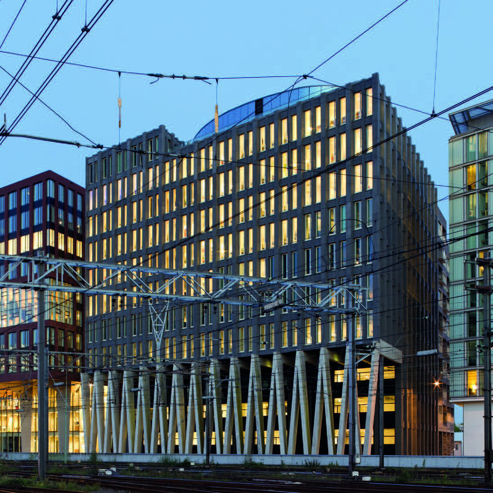
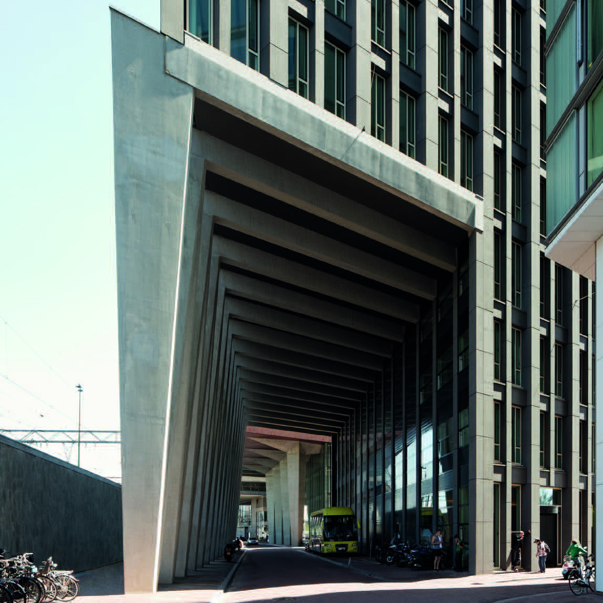
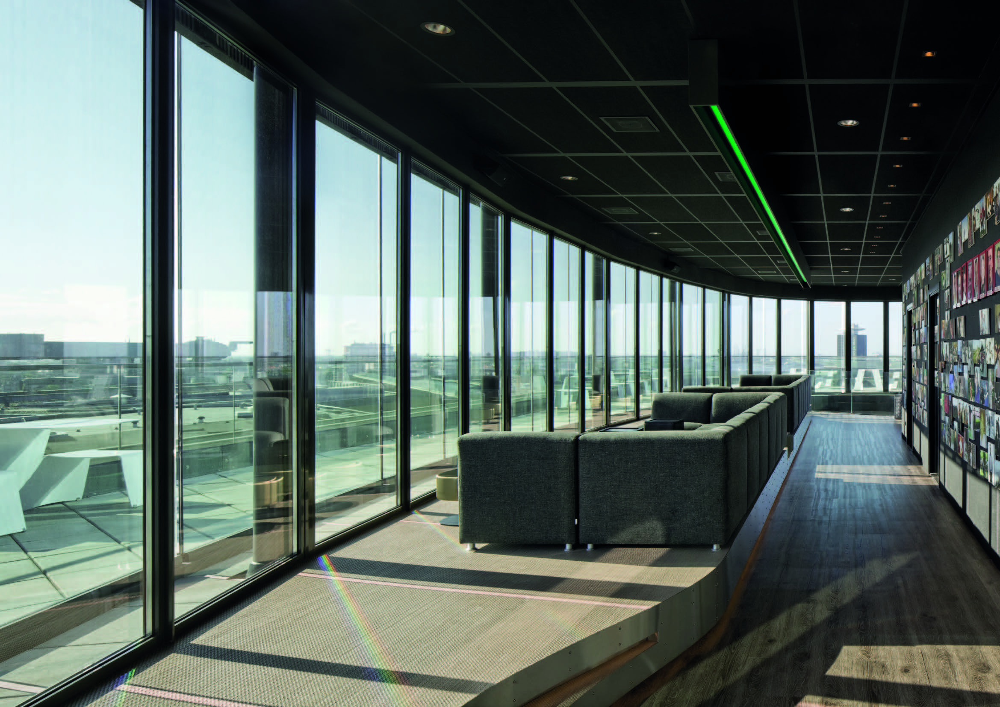
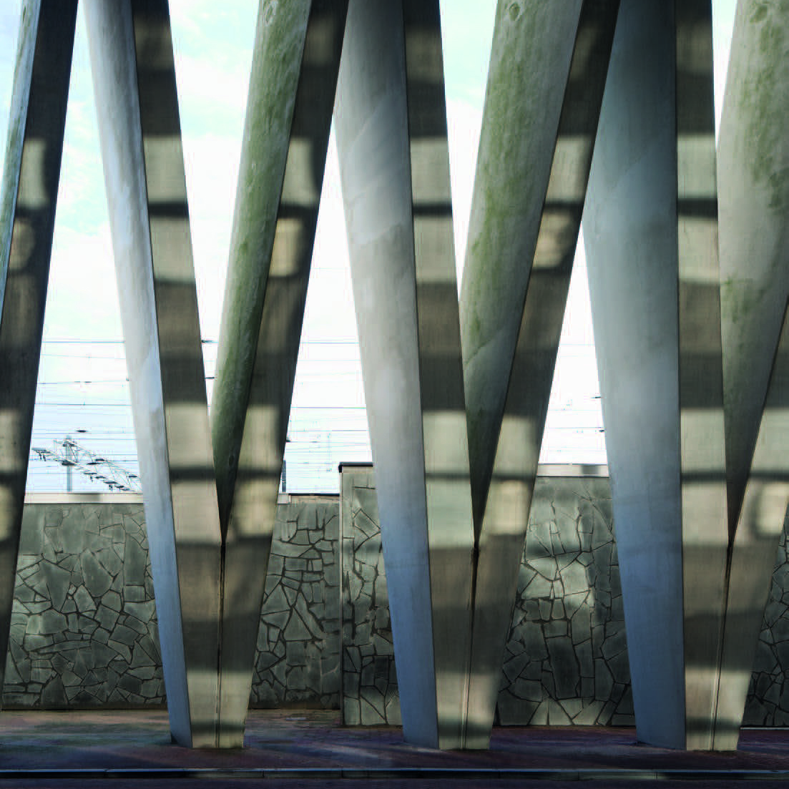
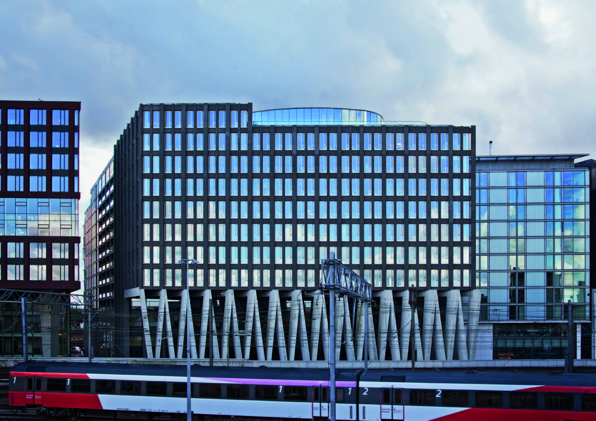

# Dietmar Eberle

#### Dietmar Eberle directs the internationally acclaimed company of Baumschlager Eberle, founded in 1985 in Vorarlberg, with ten offices around the world in eight countries.

After having taught at different universities, since 1999 Eberle has been a professor for architecture and design at the ETH in Zurich, where he also directs the ETH Wohnforum – ETH Case (Center of Research on Society and the Built Environment). Dietmar Eberle has received many national and international awards and honors and is a member of the American Institute of Architects (AIA).

[Video: Dietmar Eberle](https://www.youtube.com/watch?v=rtABEQcRjn0)

