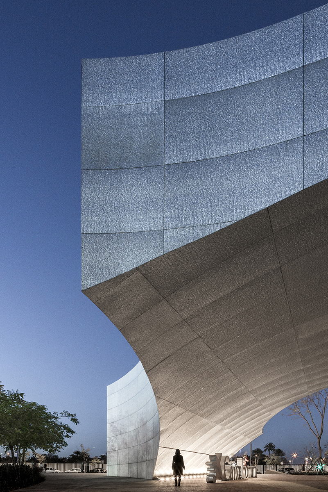
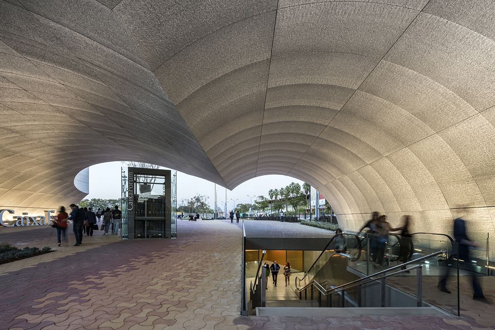
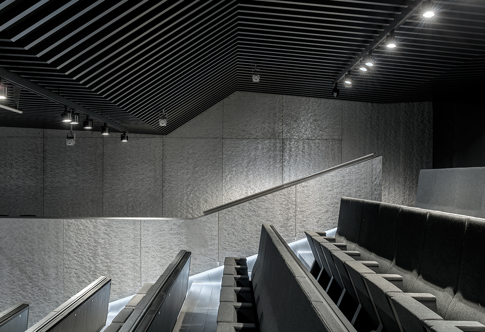
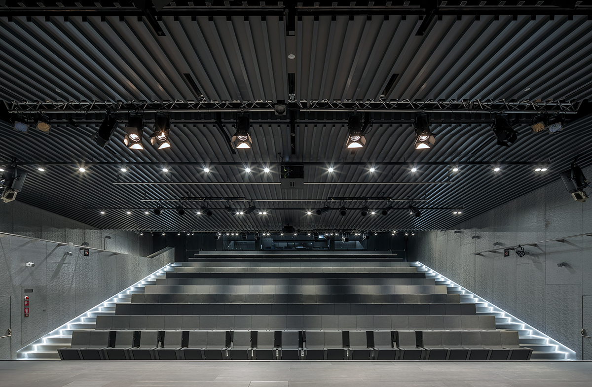
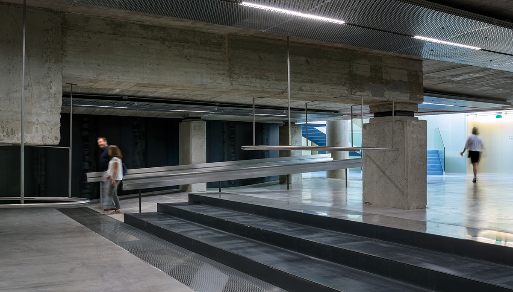
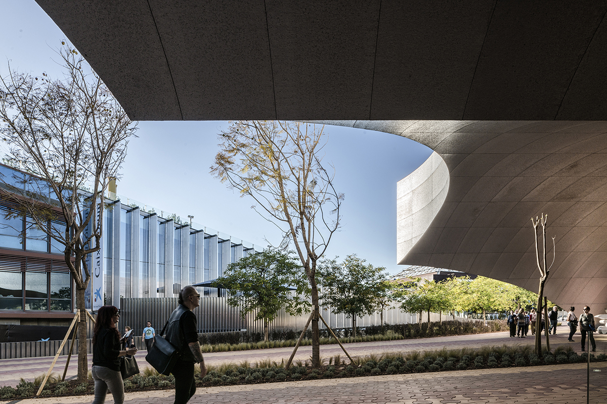
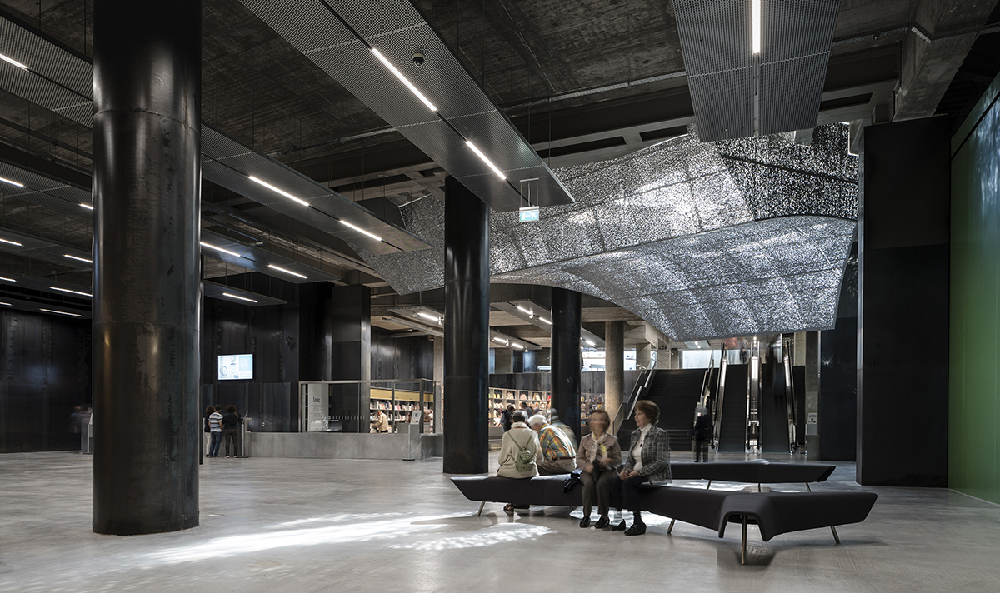

# Guillermo Vázquez Consuegra

#### At the head of his own firm in Seville from 1975, Consuegra has been conducting the professional career as well as the academic one ever since.

He has been invited to teach in Buenos Aires, Lausanne, New York City and Venice. His work has contributed to the international praise of contemporary spanish architecture, focusing on cultural buildings and national heritage restoration.

[Video: Guillermo Vázquez Consuegra](https://www.youtube.com/watch?v=FcCyNT8AD2Q)

