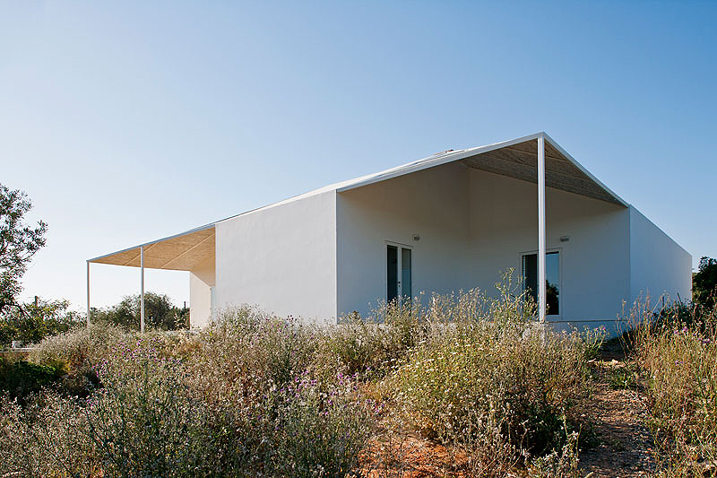
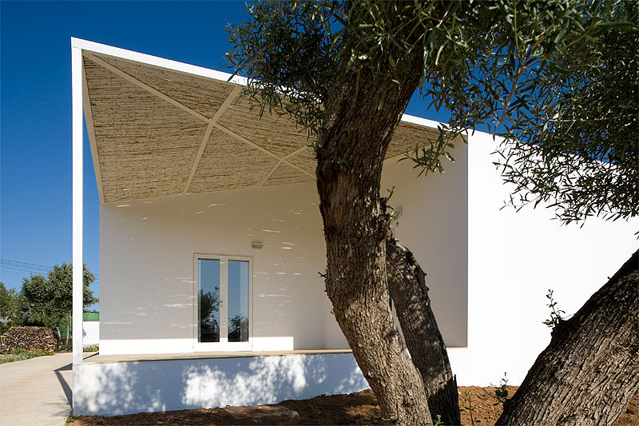
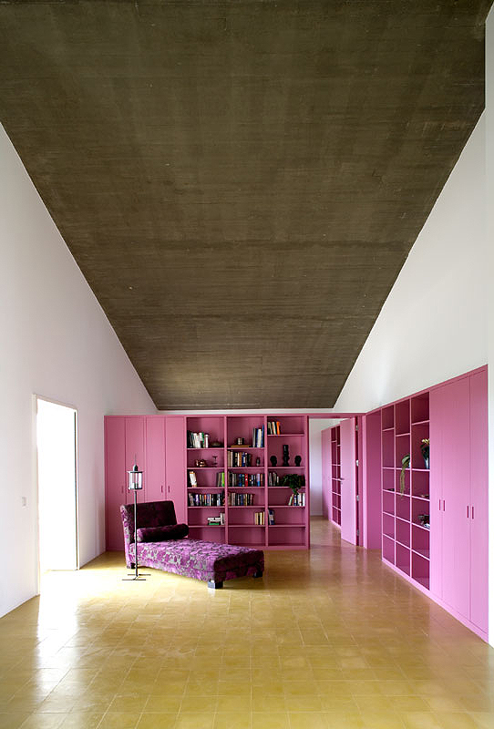
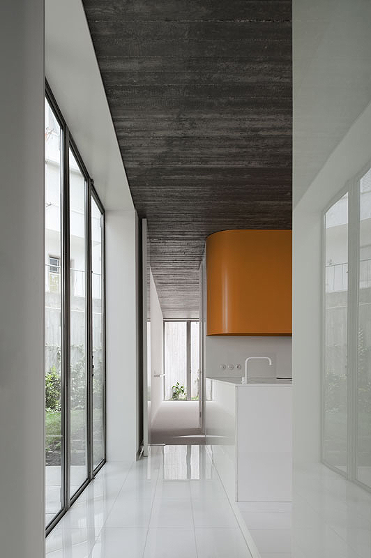
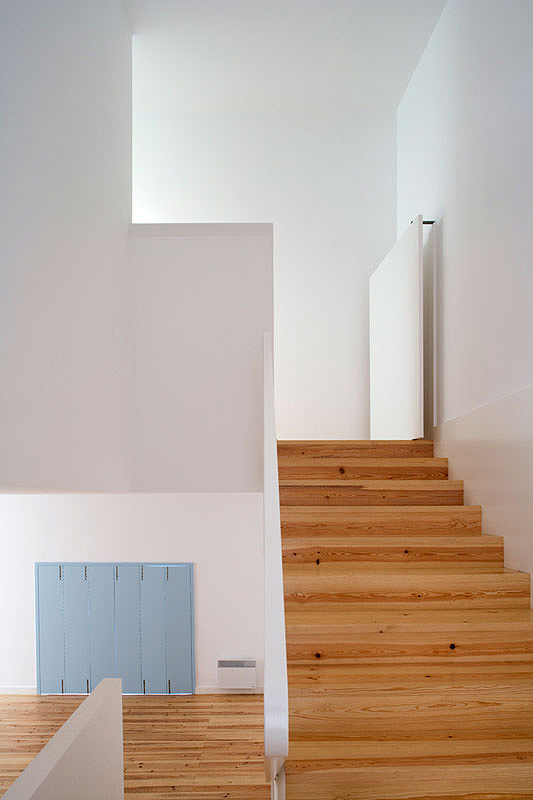
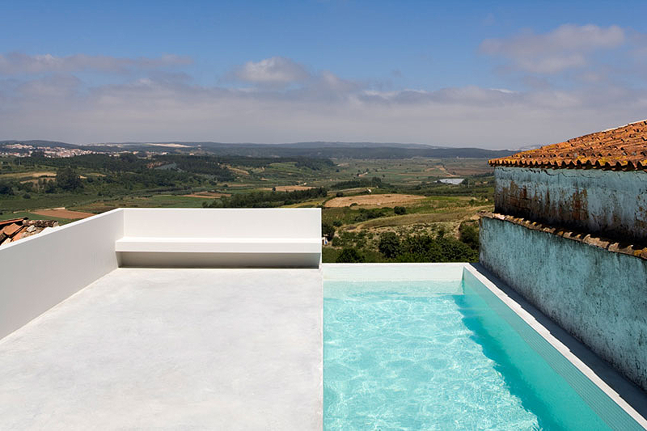
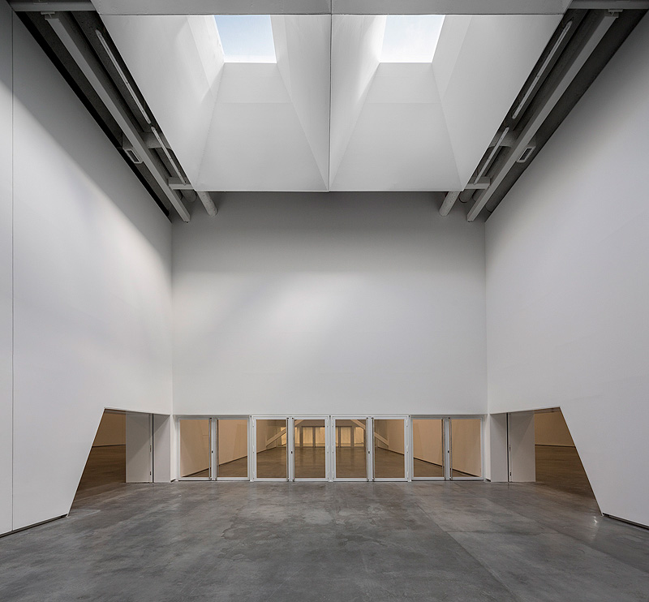
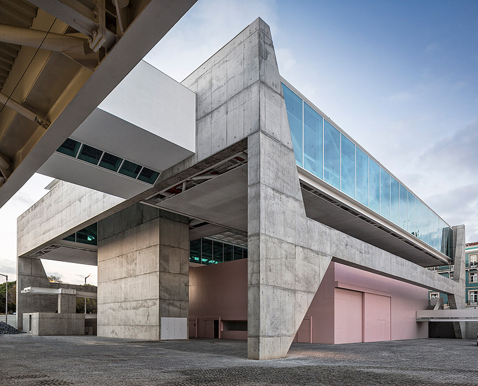

# Ricardo Bak Gordon

#### Ricardo Bak Gordon studied in Lisbon, Milan and Porto and founded his own firm Bak Gordon Arquitectos in 2002.

Recipient of numerous awards such as the Premio FAD (2011) and two nominations for the Mies van der Rohe Award (2009 and 2011), his work was presented in many occasions in Spain, Italy, Mexico, Ecuador and Brazil and he has lectured as visitor professor in Barcelona, Harvard, Milan and Tokyo universities.

[Video: Ricardo Bak Gordon](https://www.youtube.com/watch?v=GIt8RdBZrMw)

