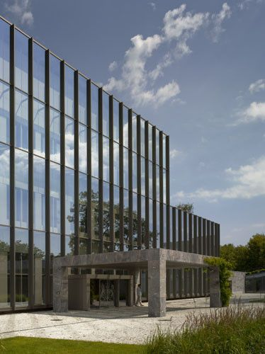
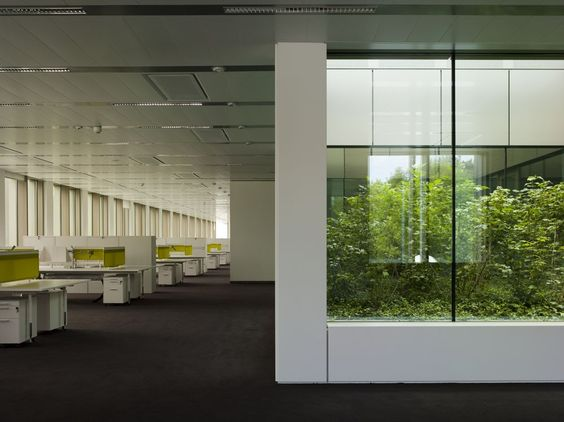
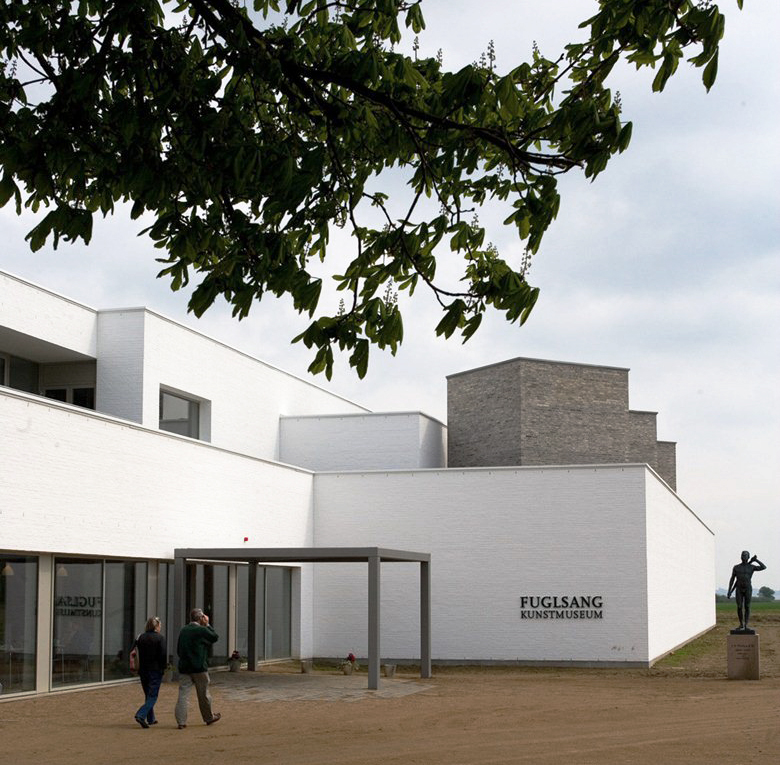
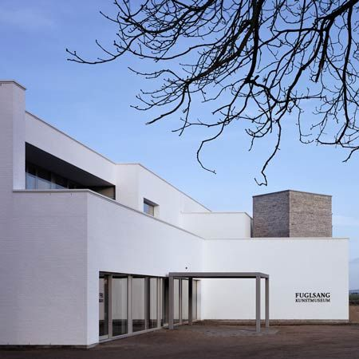
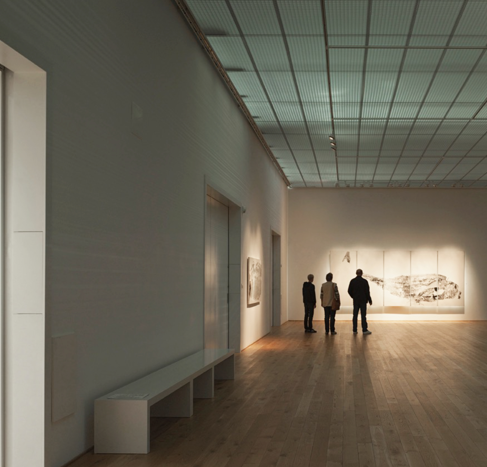
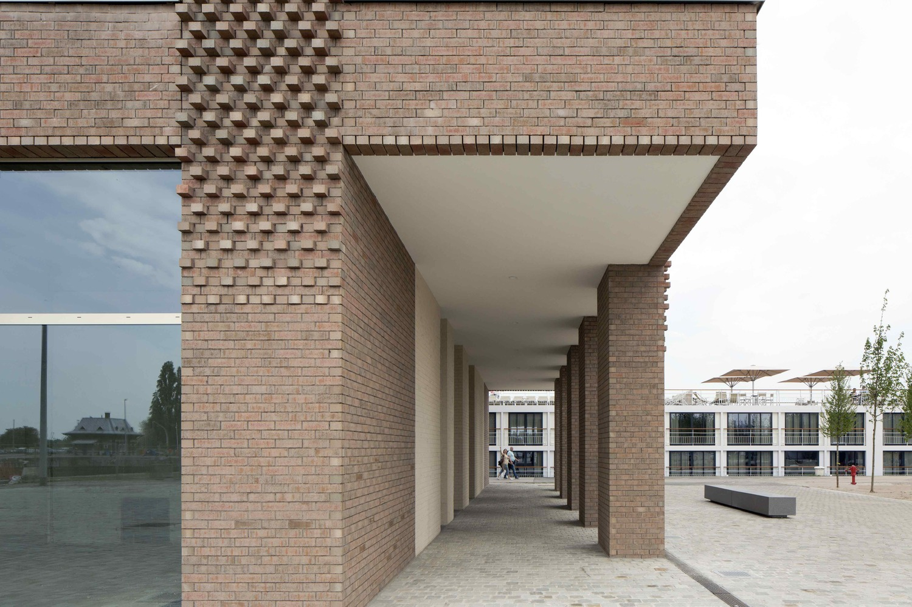

# Tony Fretton

#### Tony Fretton Architects was founded in 1982 in London and nowadays has an international reputation.

The buildings completed by the practice in London for the Lisson Gallery in 1986 and 1992 continue to be recognized as exemplary spaces for art, for the architectural experiences they offer and for their social engagement with the surrounding city. Fretton is now Professor Emeritus at TU Delft and has taught in Lausanne, Amsterdam, London and Harvard.

[Video: Tony Fretton](https://www.youtube.com/watch?v=gMvr8TD-vB8)

