# Sou Fujimoto

#### Sou Fujimoto graduated from the University of Tokyo with a degree in architecture in 1994 and six years later established an eponymous firm, Sou Fujimoto Architects.

In 2008, he constructed both the Final Wooden House, in Kumamoto, Japan and the House N, in Oita, Japan. In addition, Fujimoto has undertaken several cultural projects, such as the critically acclaimed Musashino Art University Museum and Library in Tokyo (2010) and the Serpentine Gallery Pavilion in Kensington Gardens in London (2013).

He is now professor at Tokyo and Kyoto Universities and has been the recipient of numerous awards and accolades for his creative and innovative designs, including the 2008 Japanese Institute of Architecture Grand Prize; the 2007 Kenneth F. Brown Architecture Design Award; “Grand Prize” in the AR Awards of 2006; “Gold Prize” in House Competition by Tokyo Society of Architects and Building Engineers 2006; “1st Prize” in Wooden House Competition in Kumamoto, 2005; “1st Prize” in International Design Competition for the Environment Art Forum for Annaka and the JIA New Face Award 2004 among many others. In 2012 Fujimoto was a member of the team winning the Golden Lion at the Architecture Exhibition in Venice.

[Video: Sou Fujimoto](https://www.youtube.com/watch?v=EML7uDJNprk)

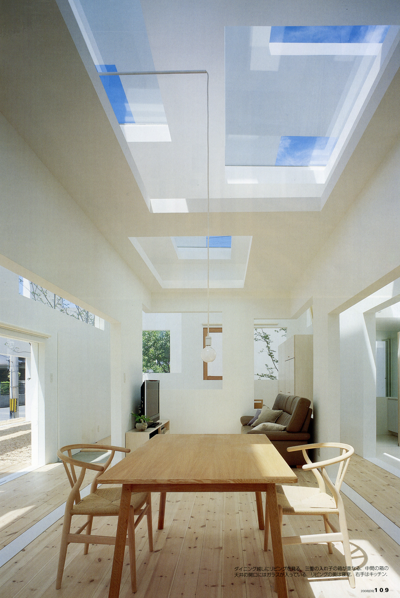

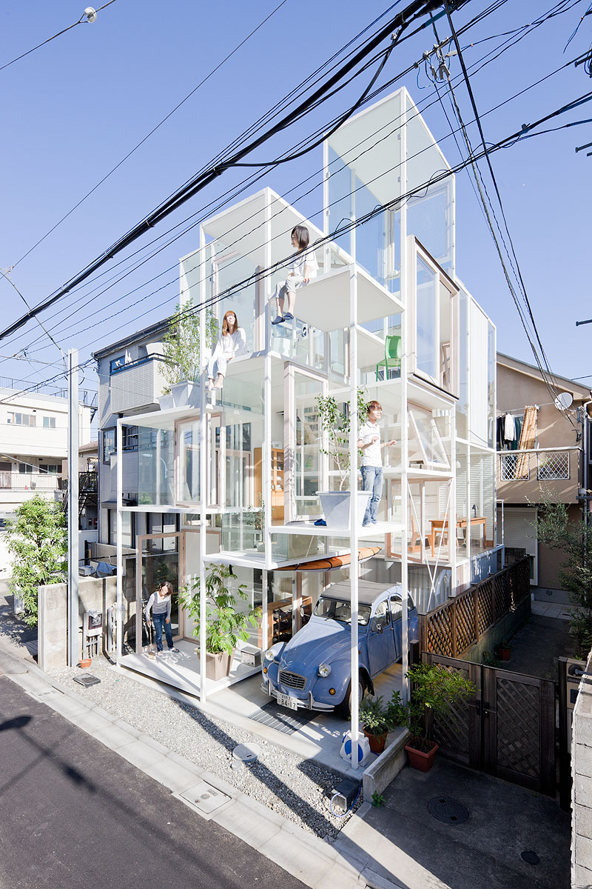

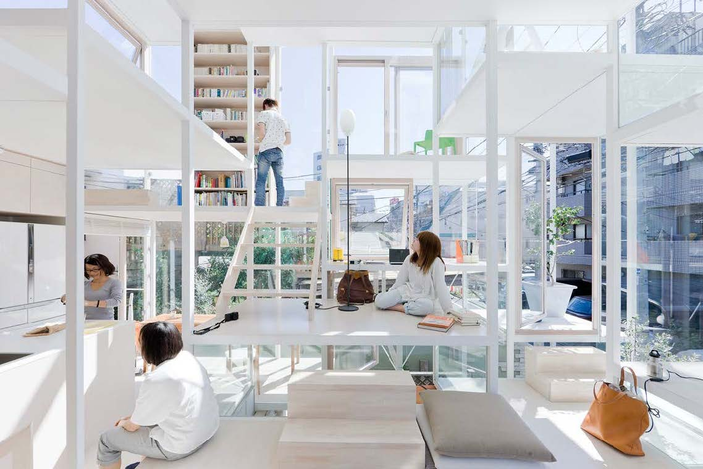

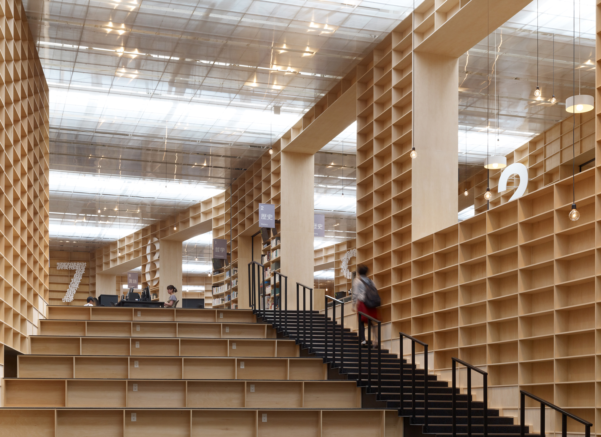

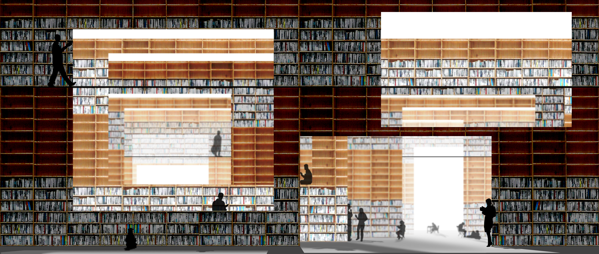

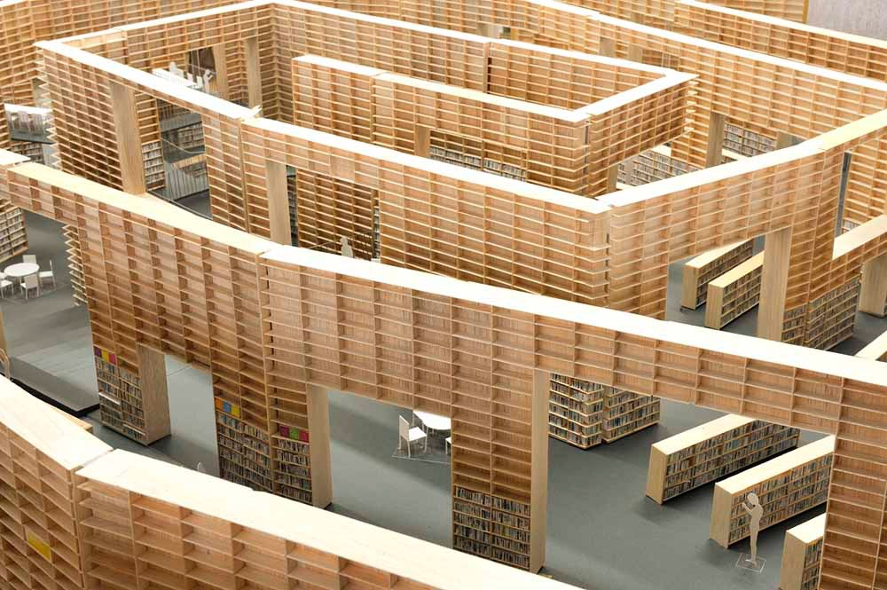

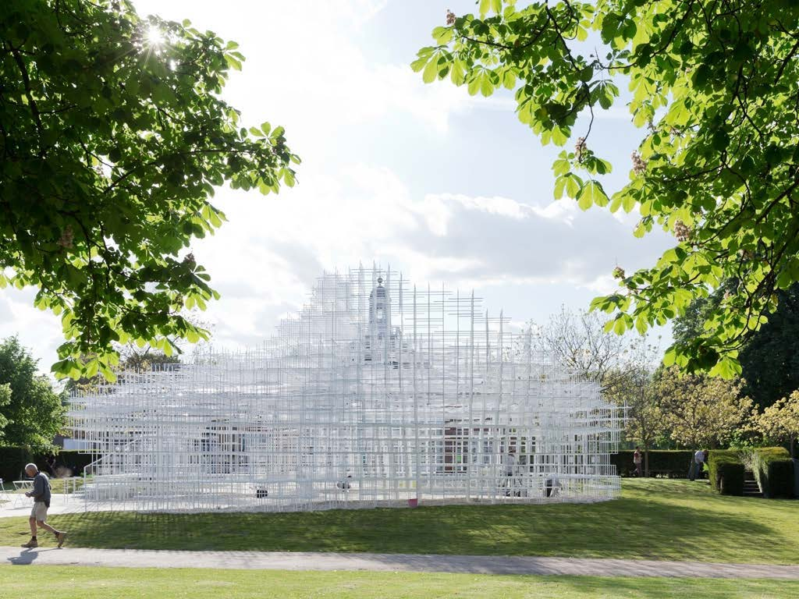

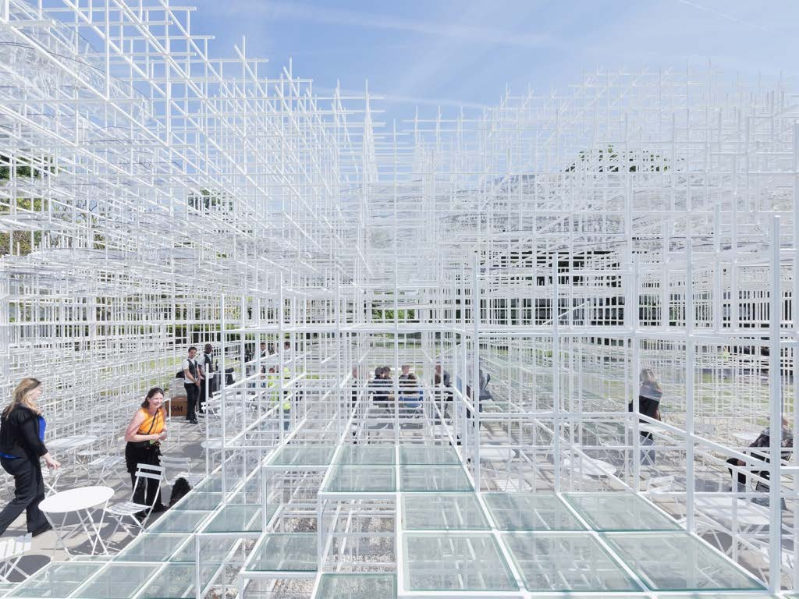

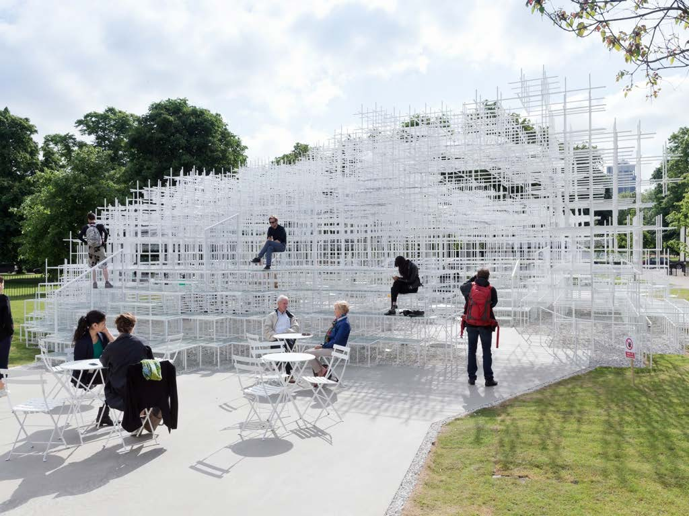

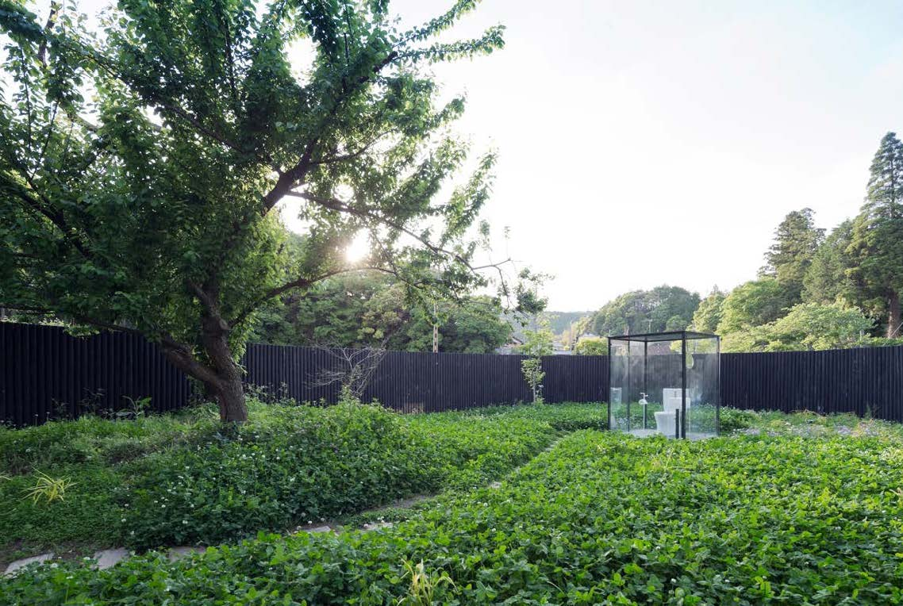

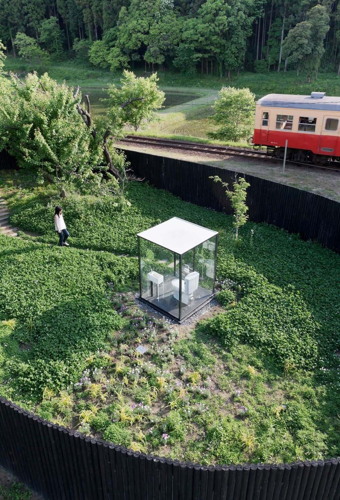

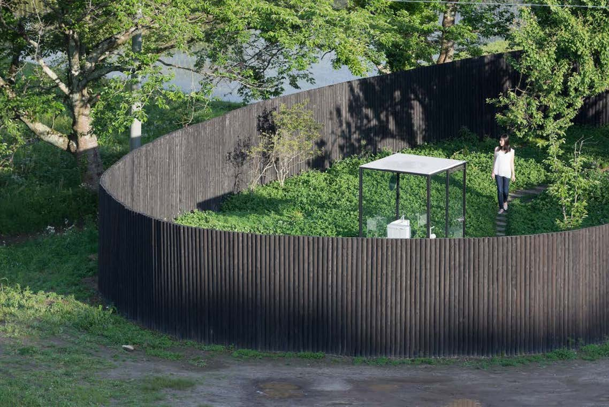

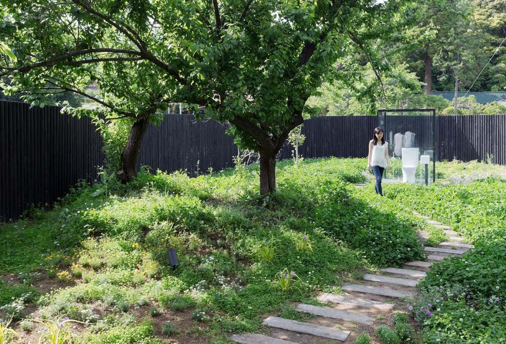
