# TAMassociati

#### TAMassociati was founded in 1996 in Venice by Raul Pantaleo, Massimo Lepore and Simone Sfriso and now has offices also in Bologna and Paris.

They combine social and technical commitment, working on the fields of sustainable architecture, urban planning, landscape design, participatory processes, graphic design and social communications.  
The firm has been frequently involved in social and humanitarian projects and it is particularly known for its works for the NGO Emergency.

TAMassociati has exposed its works in many exhibitions and international events and has received many accolades including the prestigious Italian Architect of the Year 2014 «for the ability of giving value to the profession’s ethic dimension».

[Video: TAMassociati](https://www.youtube.com/watch?v=TlnSOnVE9JE&index=5)

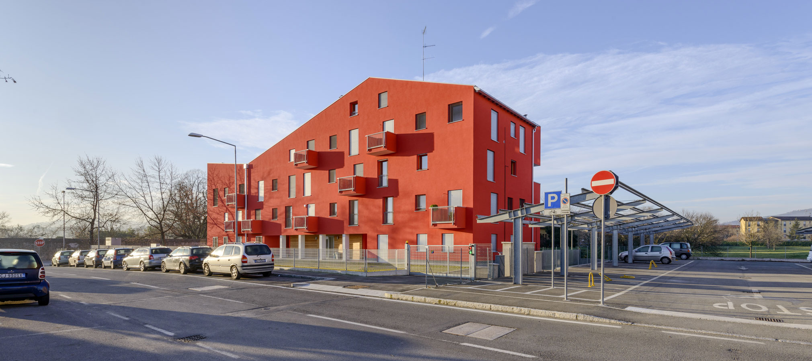

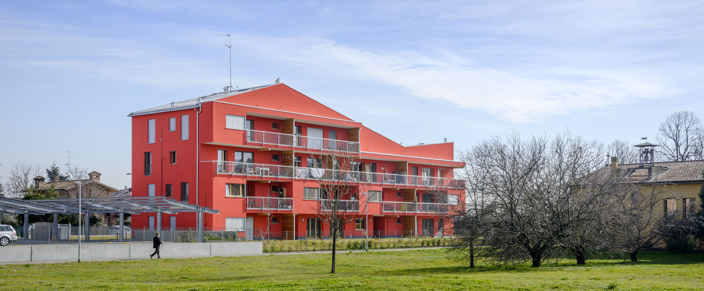

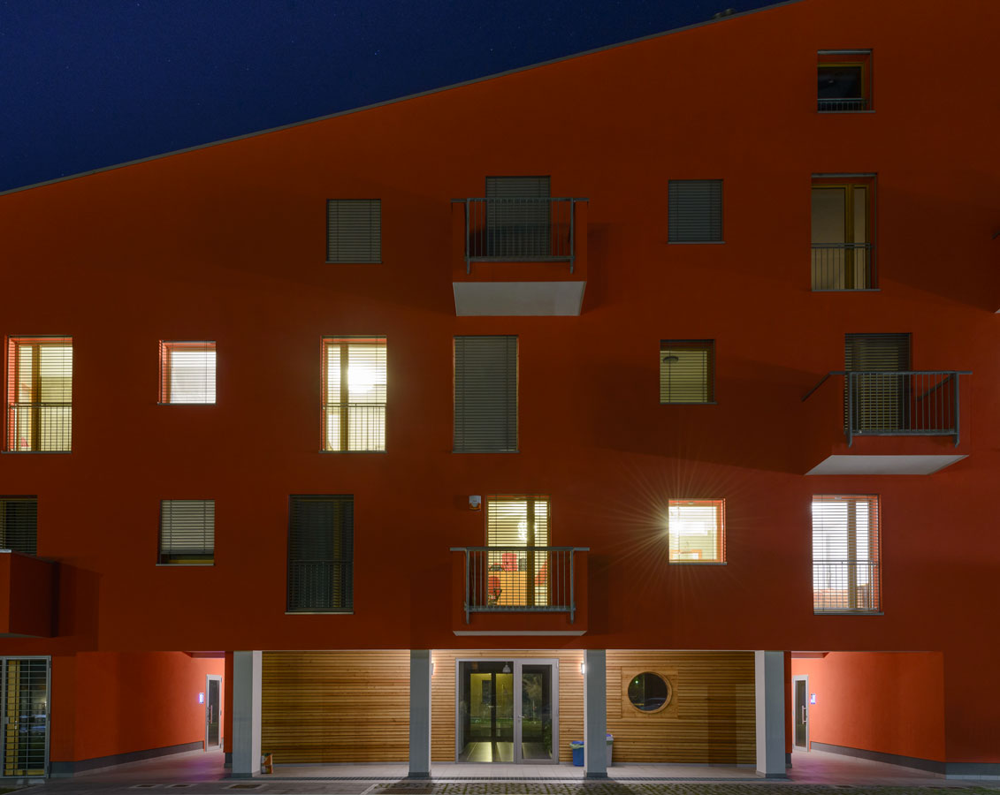

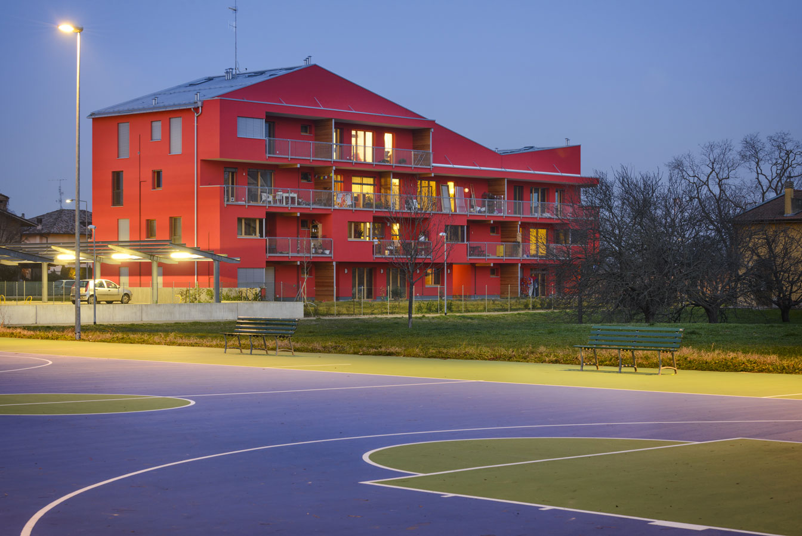

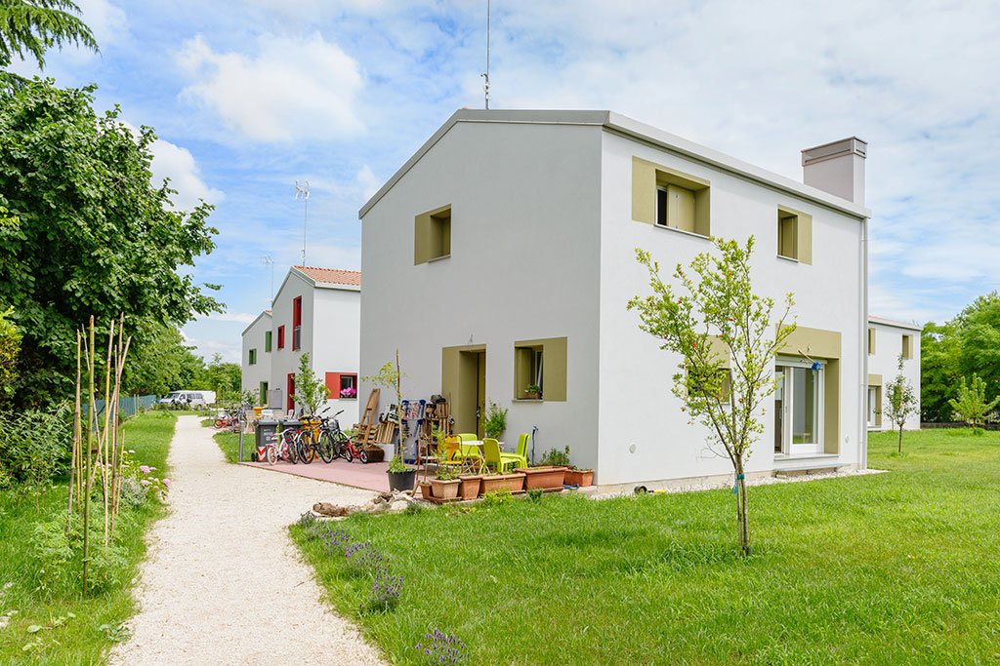

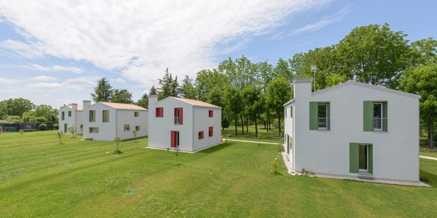

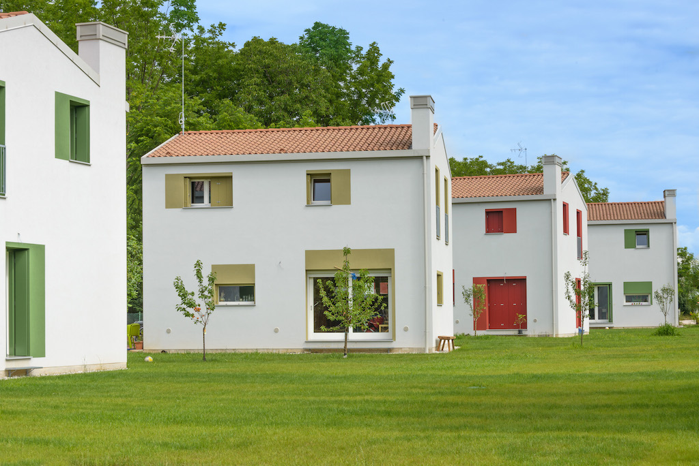

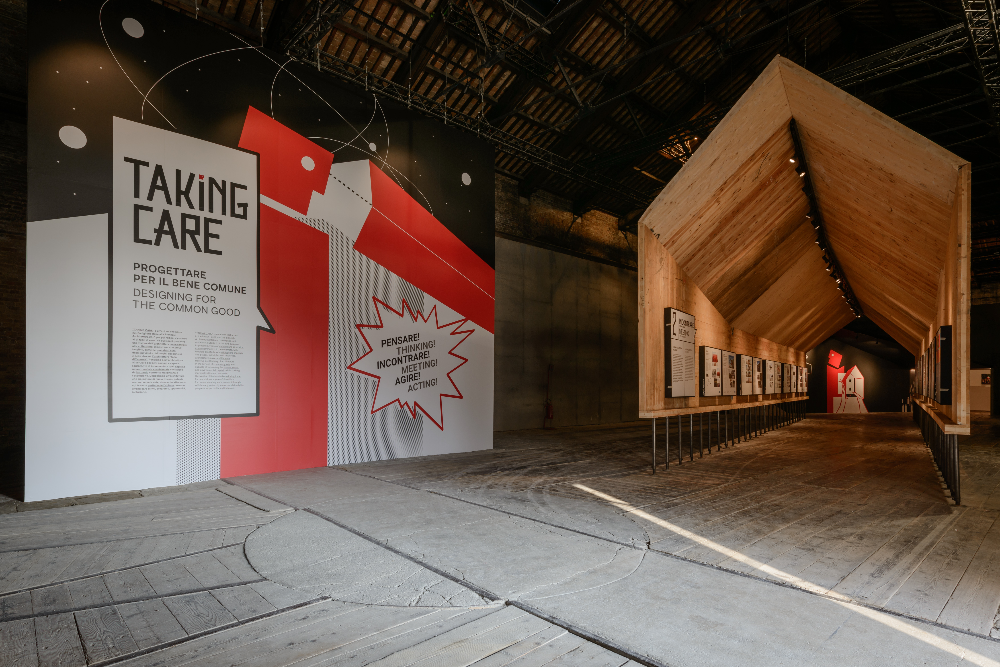

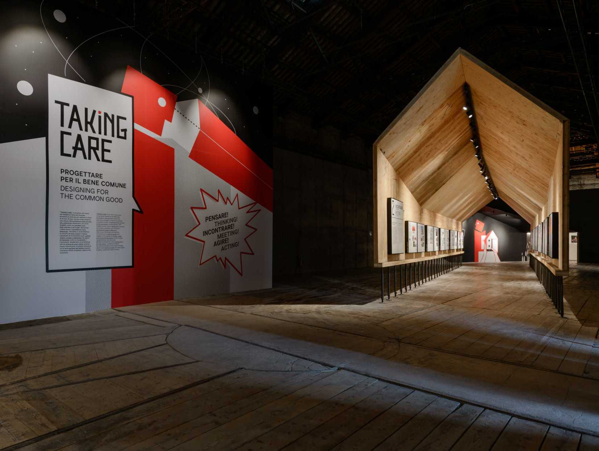

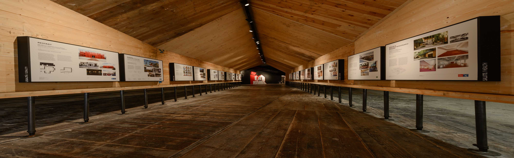

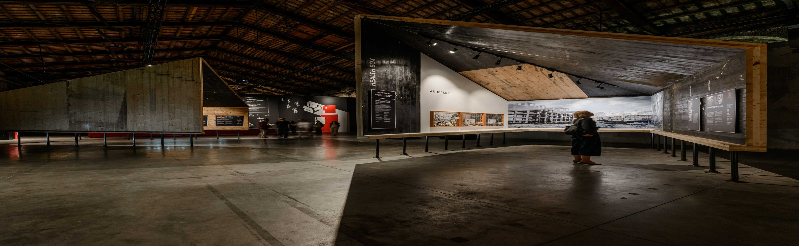
