# Carmody Groarke

#### Carmody Groarke is a London-based architectural practice founded in 2006 by Kevin Carmody and Andy Groarke. The practice has developed a reputation for working internationally on a wide range of arts, cultural, heritage and residential projects.

Completed projects include the New Architecture Gallery at the Royal Institute of British Architects headquarters, the permanent memorial to the 7 July London bombings, Frieze (London) Art Fair 2011-2013, Maggie’s Cancer Care Centre Clatterbridge Merseyside, an artist studio for sculptor Antony Gormley and a new Members’ Room for the V&A.

Current projects include (as of March 2018): the new Windermere Jetty Museum the Lake District, an extension of the Museum of Science & Industry in Manchester, a major renovation of Dorset County Museum in Dorchester, a hotel in Devon, a new studio for artist Julian Opie, several private houses and a private art gallery.

The practice has earned international recognition, winning several architectural competitions and awards for completed projects. The first monograph of the practice was recently published in the Spanish periodical, 2G.

[Video: Carmody Groarke](https://www.youtube.com/watch?v=n03rQ0iGSXg)

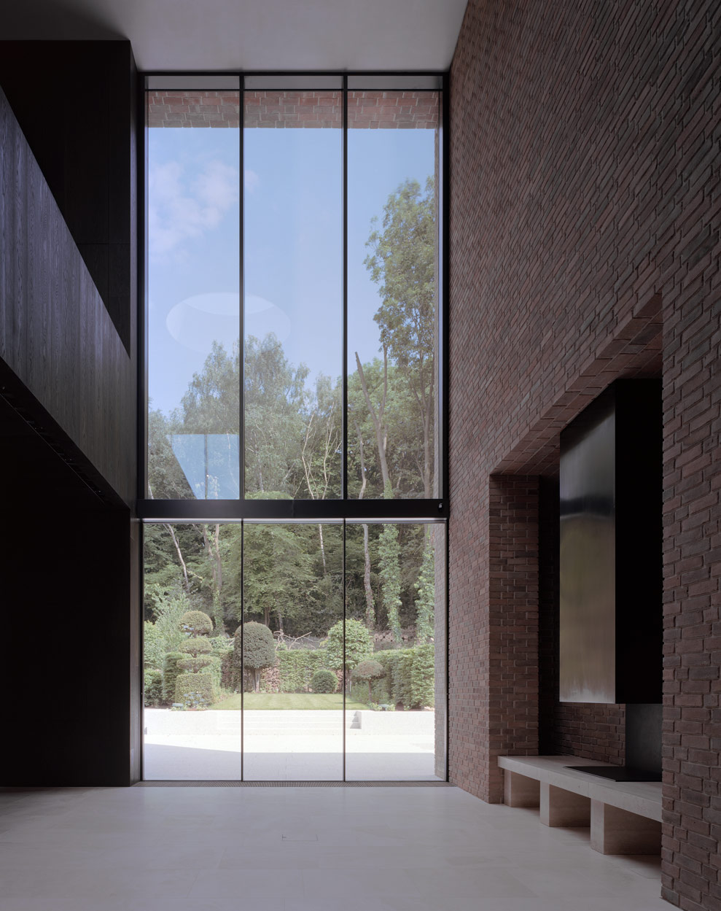

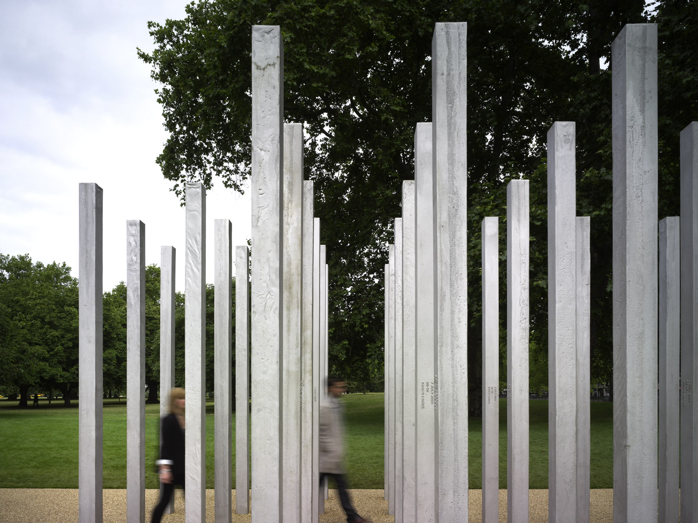

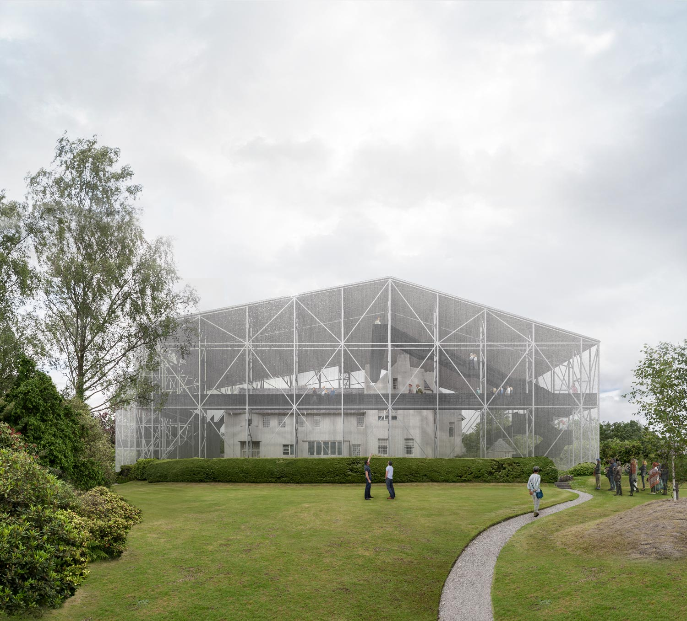

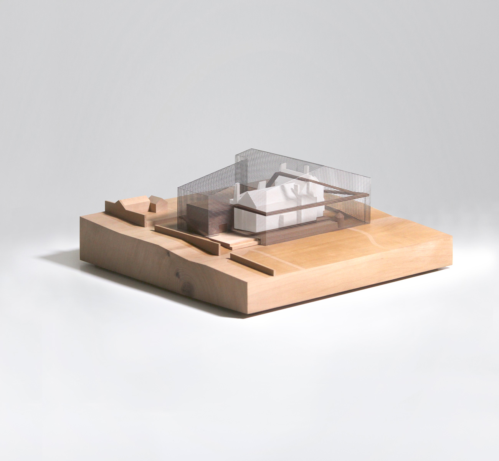

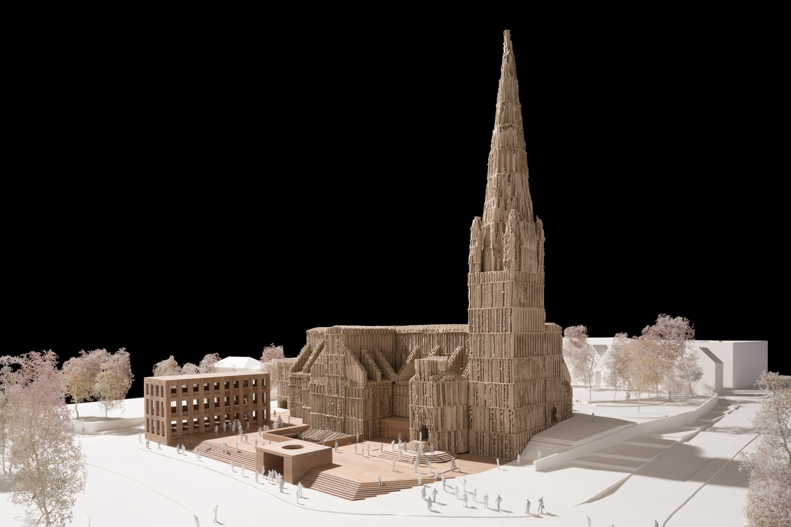

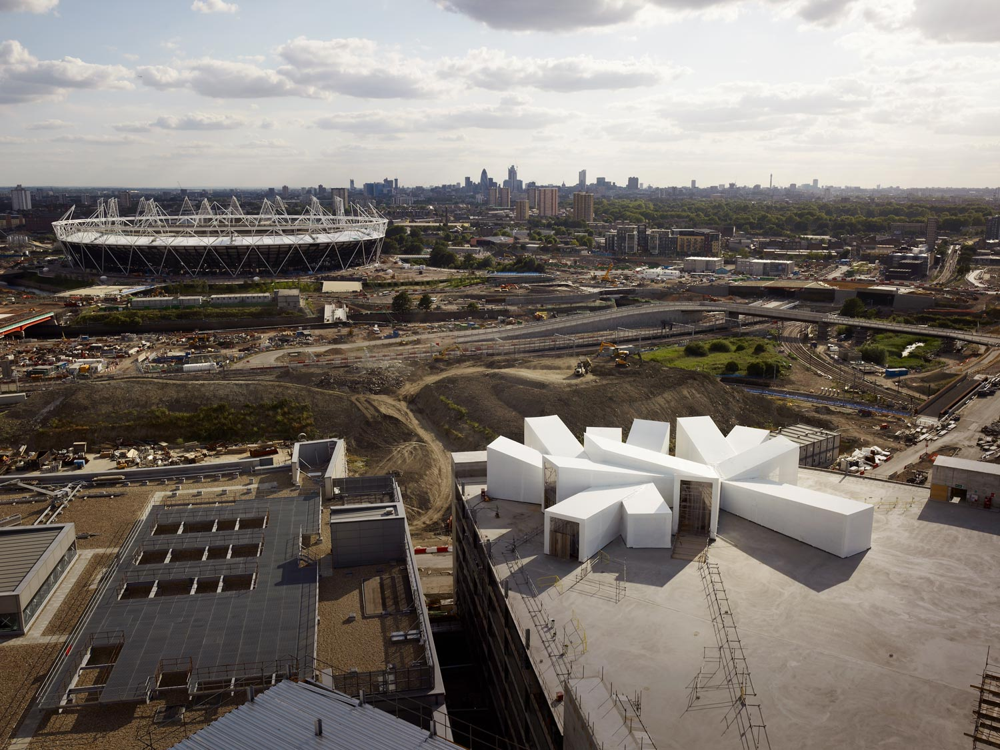

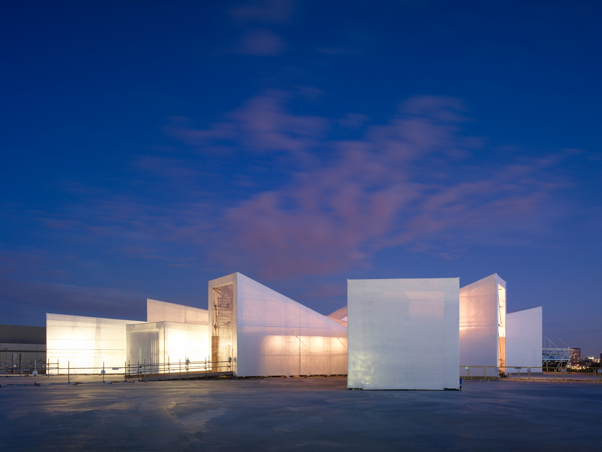

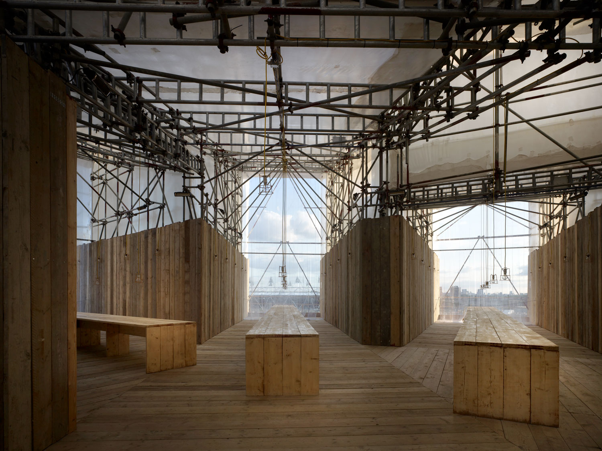

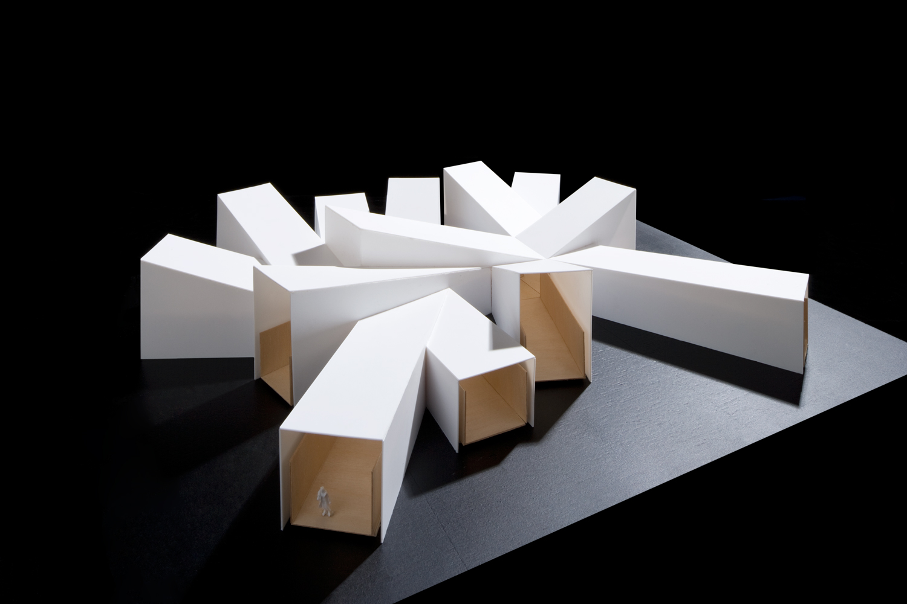

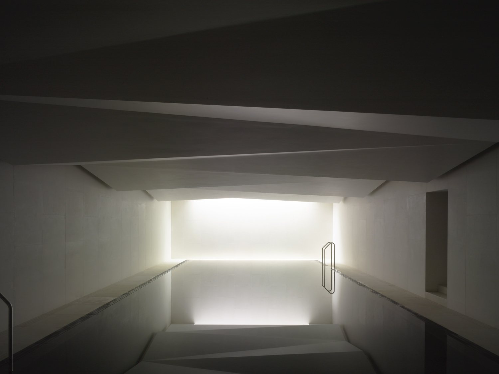

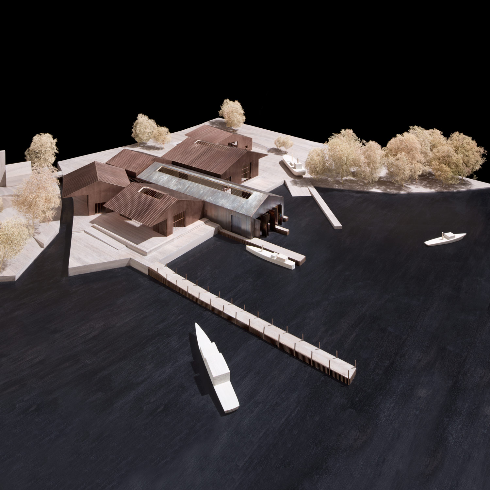
