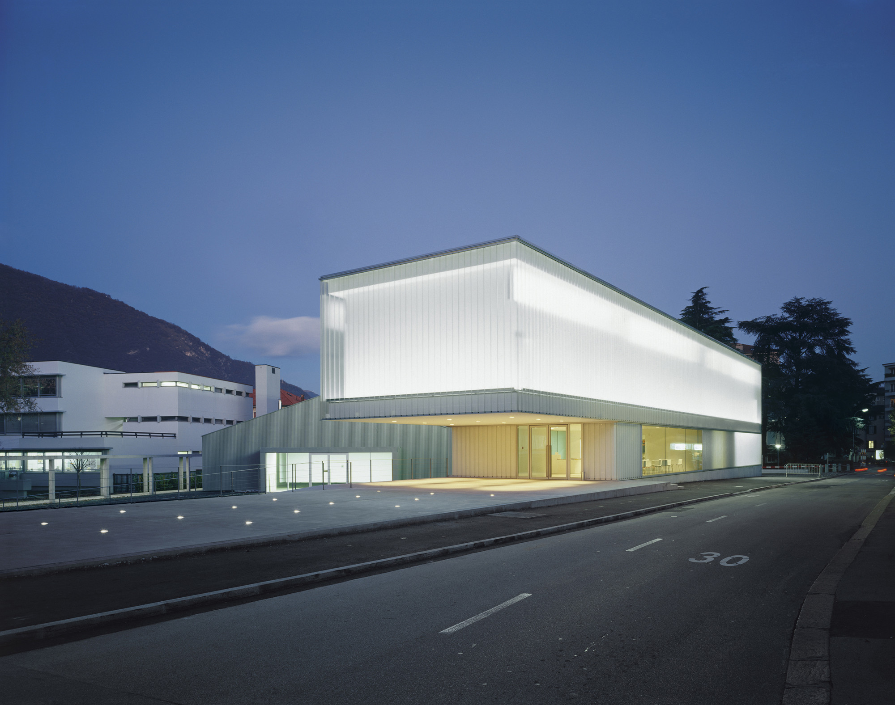
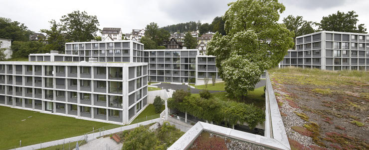
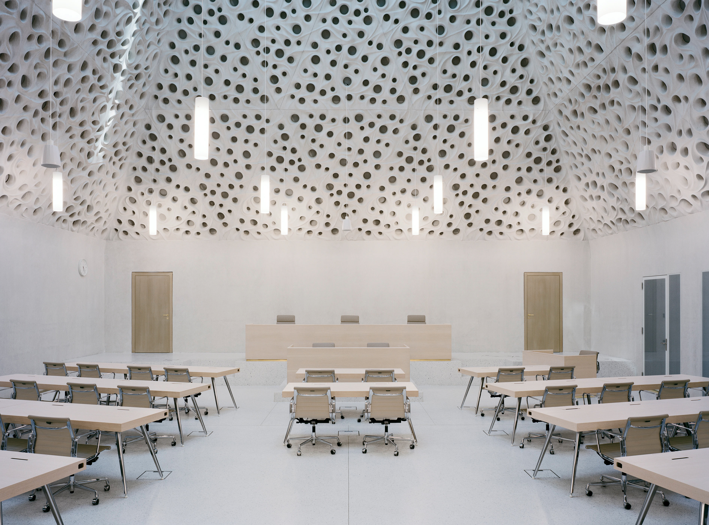
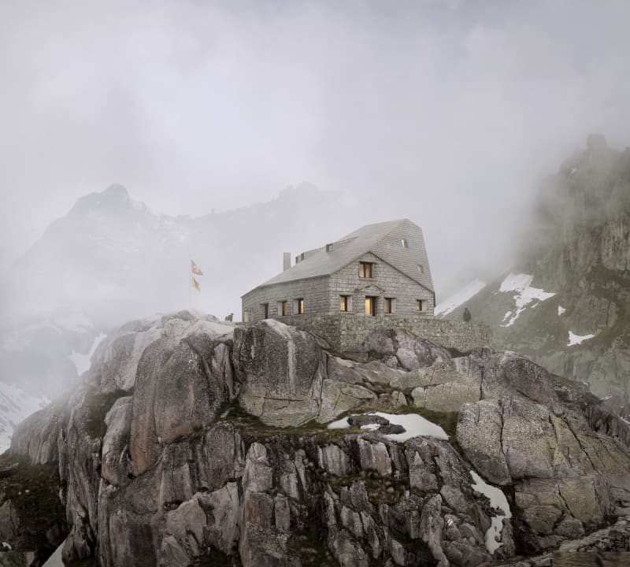
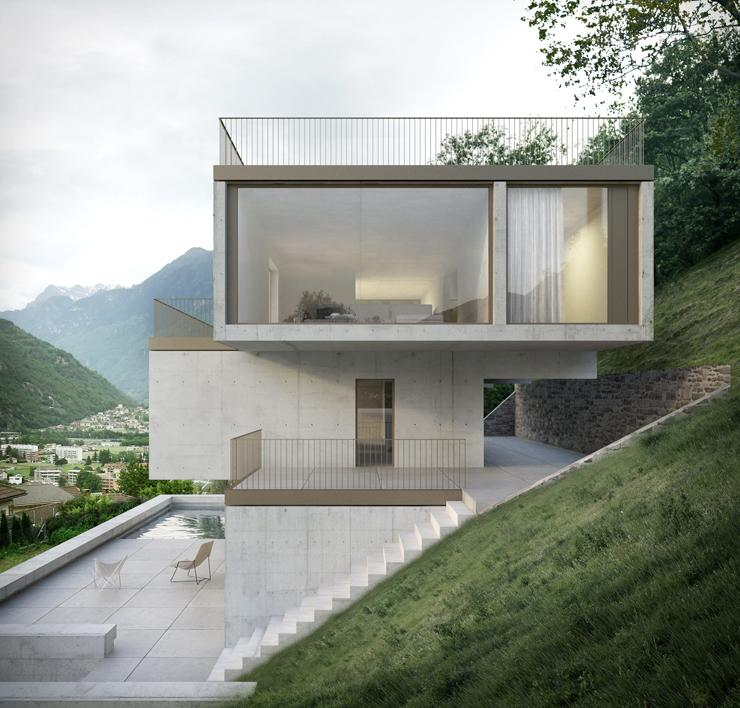
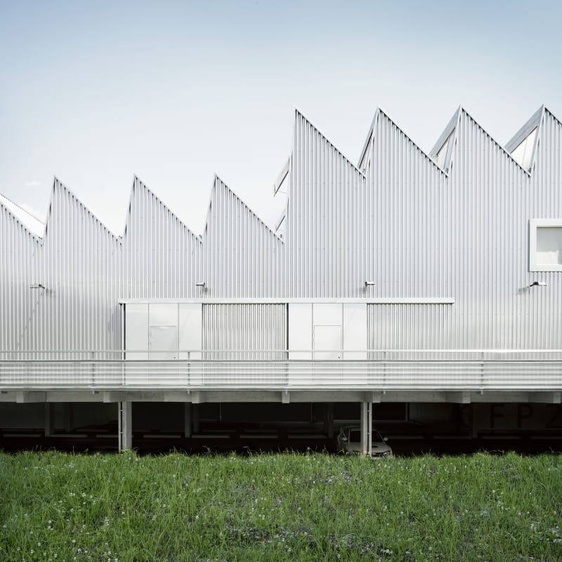
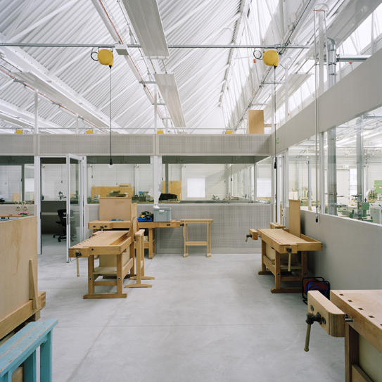
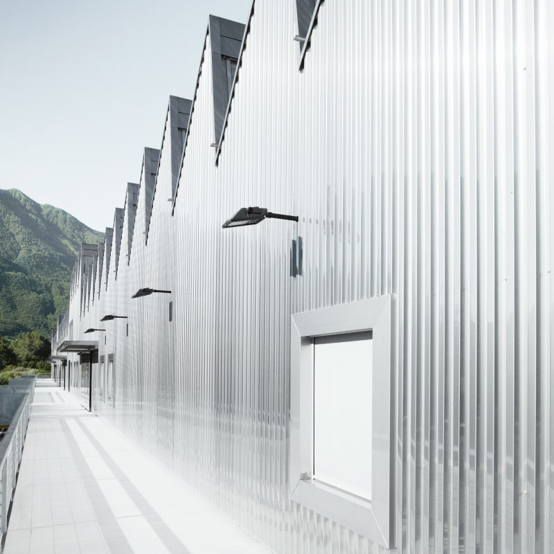
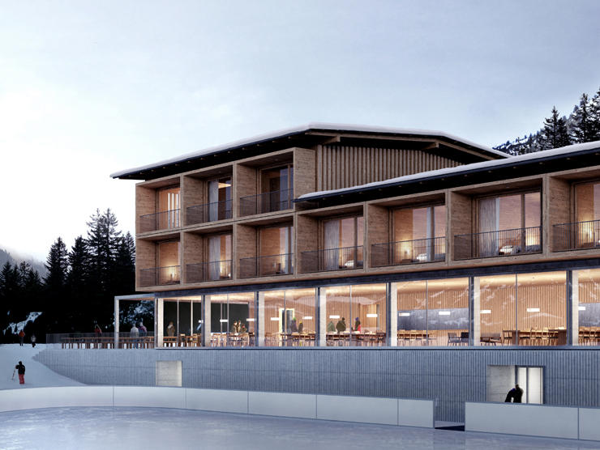
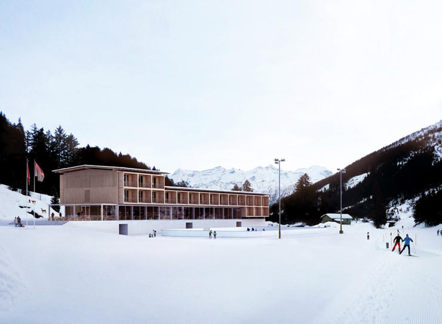

# Durisch + Nolli

### In 1993 Pia Durisch and Aldo Nolli founded the studio *Durisch + Nolli Architects* based in Riva San Vitale and since 2001 in Lugano.

In 2000 they taught at the University of Illinois (UIUC). They gave lectures and participated in seminars at various universities and institutions, such as the Illinois Institute of Technology (IIT), the University of Illinois (UIUC), the Federal Institute of Technology Zurich (ETH), the Academy of Architecture in Mendrisio (AAM), Homeland Security Switzerland.  
In 2003 they won the *SIA Award* for the best private building in Canton Ticino ( House for a Sculptor, Mendrisio, 1998-2003).  
In 2006 they tought at the Faculty of Architecture of the University IUAV of Venezia.

They have been visiting professors at the Ecole Polytechnique Fédérale EPFL in Lausanne and at the Academy of Architecture in Mendrisio (AAM).

[Video: Durisch + Nolli](https://www.youtube.com/watch?v=Zws1P9GCZso)

