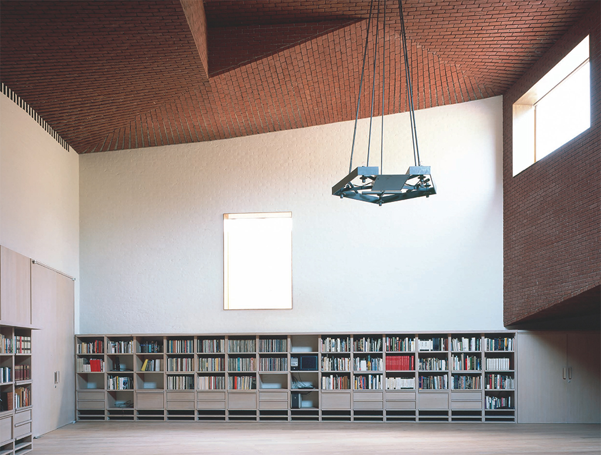
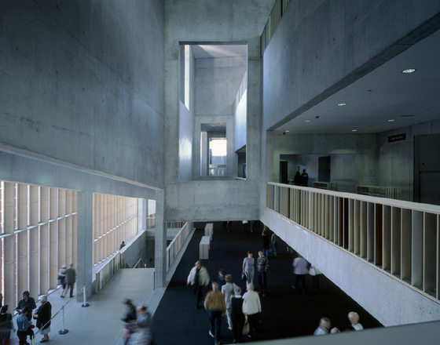
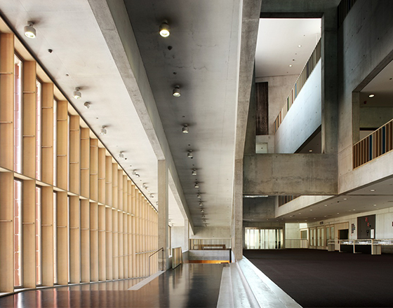
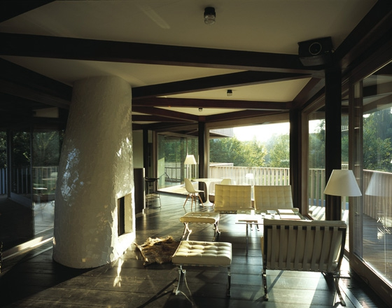
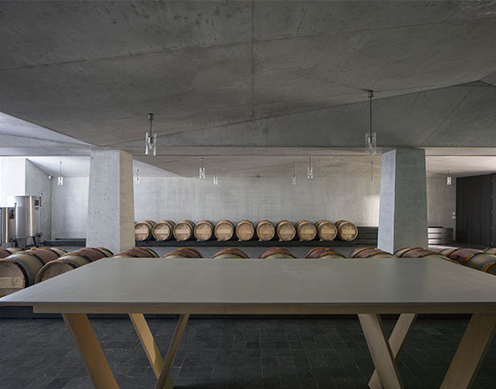
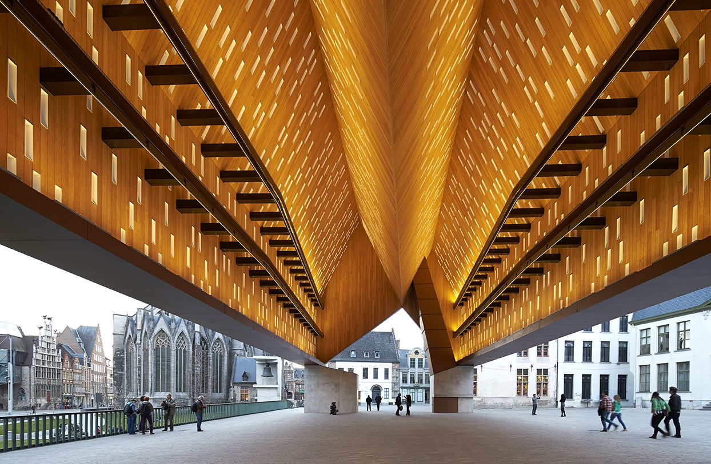
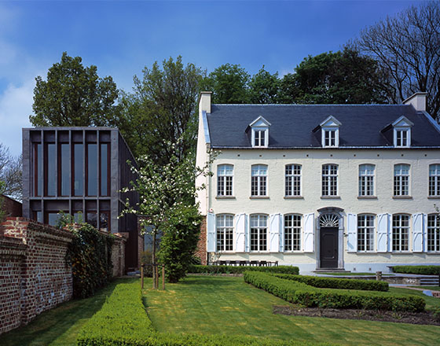
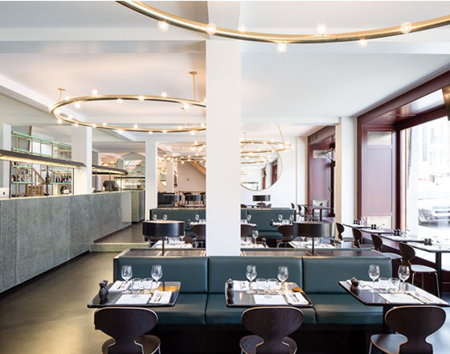

# Robbrecht en Daem

#### Founded in 1975 by Paul Robbrecht (b. 1950) and Hilde Daem (b. 1950), architectural firm Robbrecht en Daem architecten has developed a mature body of work that can hold its own on the international stage.

The wide-ranging, international portfolio comprises an impressive number of architecture and infrastructure projects, interiors and landscapes. The constant quality of the realisations is always the result of a precise architectural vision that has characterised the practice from the start and that to this day forms the basis of a meticulous project approach.

In 2002 Johannes Robbrecht (b. 1977) joined the team of Robbrecht en Daem architecten. In 2012 he became a partner.

The work of Robbrecht en Daem architecten has been published widely and internationally (A+U, Abitare, Bauwelt, Detail) and is the subject of monographic publications (Works in Architecture, 1998; Pacing Through Architecture, 2009; 2G n°5, 2010; An Architectural Anthology, 2017). In 2010, Paul Robbrecht and Hilde Daem were made International Fellow of the Royal Academy of British Architecture (RIBA). In 2013, together with Marie-José Van Hee architecten, Robbrecht en Daem architecten received the European Union Prize for Contemporary Architecture / Mies van der Rohe Awardfor the emblematic project of the city pavilion in Ghent (2012).

[Video: Robbrecht en Daem](https://www.youtube.com/watch?v=14-pFSp81Cw)

