# ARX Portugal

#### ARX ​​Arquitectos is a design studio founded in Berlin (1991) by Nuno and José Mateus. and then established in Lisbon.

Nuno Mateus, born in Castelo Branco (Portugal) in 1961, graduated in Architecture at the Universitade Técnica in Lisbon (FAUTL) in 1984. He worked in the studio of Peter Eisenman from 1987 to 1991 and Daniel Libeskind in 1991. After a master’s degree in Science of Architecture at Columbia in New York, he currently teaches at the FAUTL and at the Universidade Autónoma de Lisboa and is a visiting professor at the Universitat Internacional de Catalunya (ESARQ-UIC) in Barcelona.

José Mateus, born in Castelo Branco (Portugal) in 1963, graduated in Architecture at the Universitade Técnica in Lisbon in 1986. He is President of the Assembly of the Order of Architects of the South of the Region and was director of the Architecture Triennial of Lisbon from 2007 to 2010.

The studio has won many national and international awards and nominations as the *Prémio Municipal de Arquitectura de Mafra* in the category of New Buildings, *The International Architecture Awards* in 2006, 2008, 2009, 2012, the *European Union Prize Mies Arch* in 2013 and in 2014, the *Architecture Prize Enor* in 2014 and the *BREEAM International Prize* in the Category Sustainable Certification Project in 2012.

> «Our architecture does not follow a lexicon, or a fixed language. In each new case, we try to find the “vocabulary” for a specific language of this new context. Rather than looking for the commonalities between each new project and the previous one, we are interested in finding the differences. It’s like we always go back to zero. And at a certain level, it is this idea of ​​innovation that interests us.
>
>
>
> Of course this approach also opens up a very broad field of research. Not having to work within fixed assumptions, we look for an experimental way, where we can test new concepts from what interests us and fascinates us. However, the words of the Brazilian poet and philosopher Antonio Cícero seem to us to be wise: “What matters is not so much to write something new. It’s writing something that reading does not age.”
>
>
>
> The future is always difficult to predict, but, demonstrably, after revolutions, disinterest in history and globalization, there will certainly be a return to the specific local culture, to the architecture made of small but solid impulses from the things that come to us.»

---

[Bibliography](https://drive.google.com/open?id=1kg5kSiTBlo3wxvaSwzVq0IG_FvREeT2KpW0q96d3bUY)

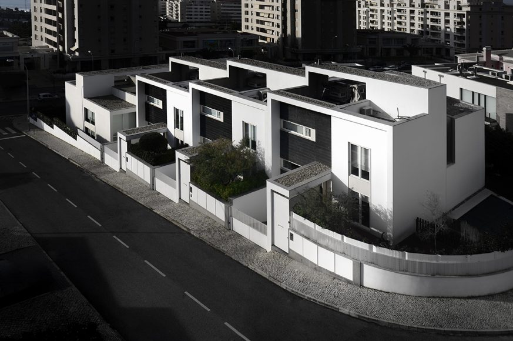

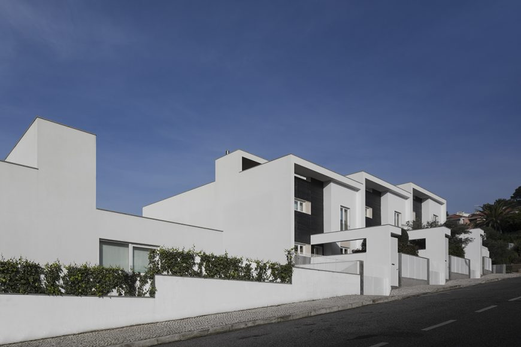

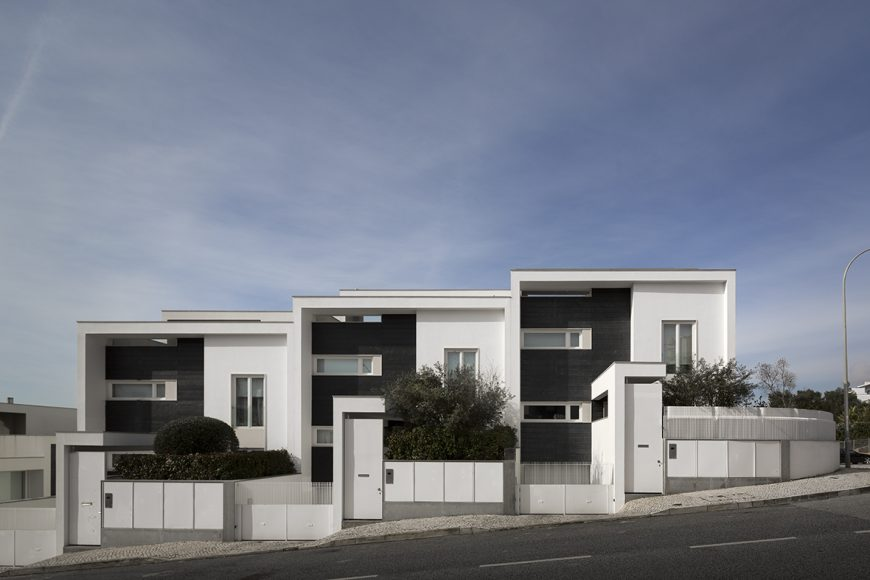

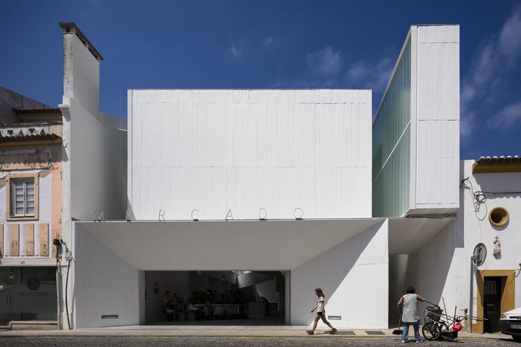

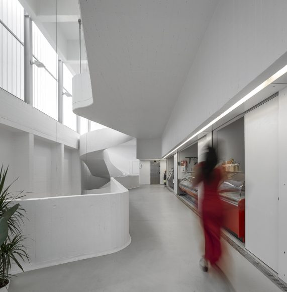

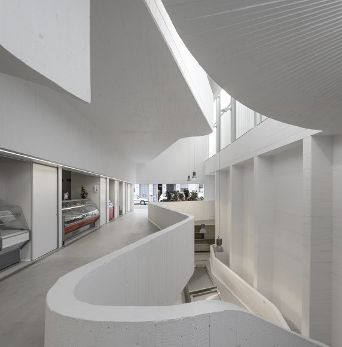

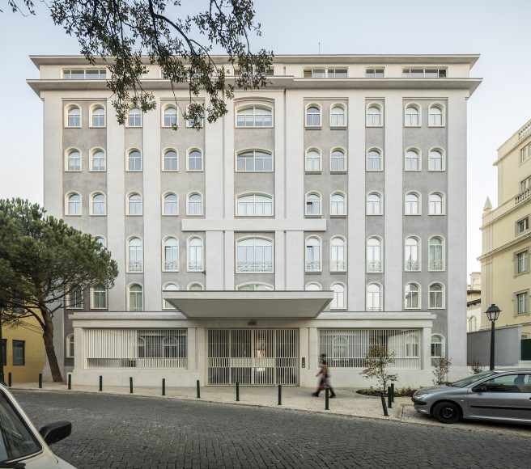

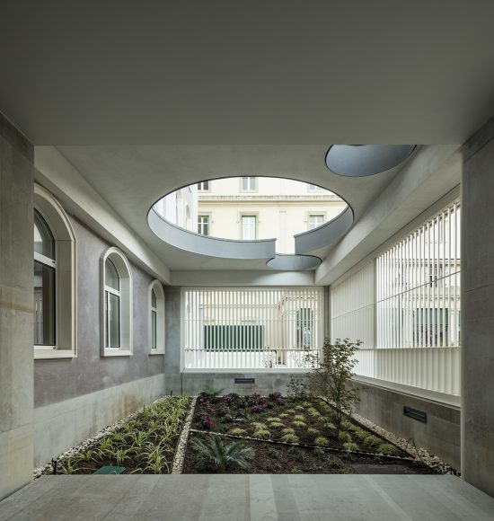

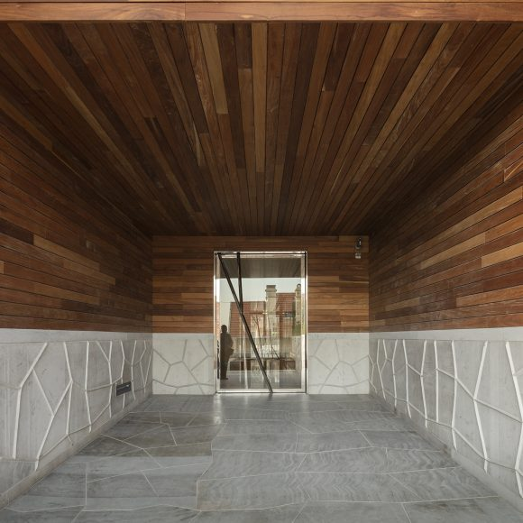

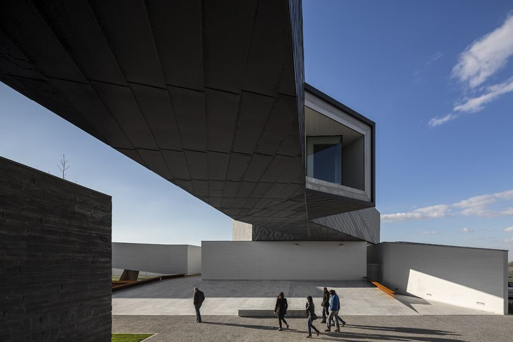

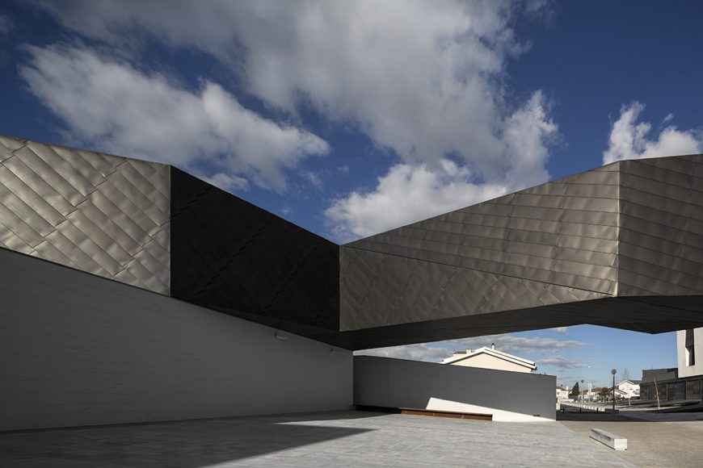

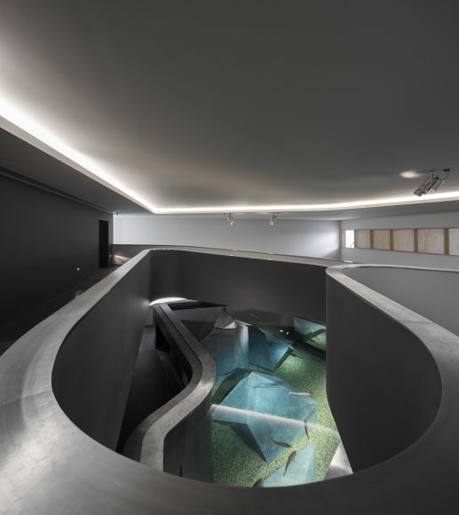

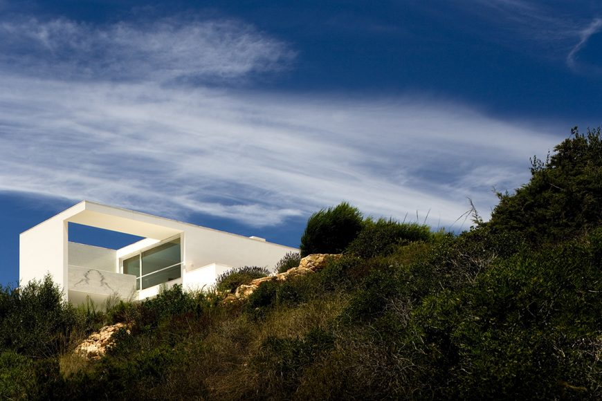

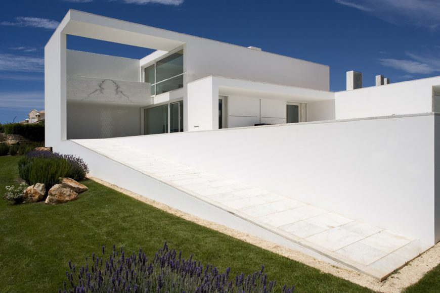

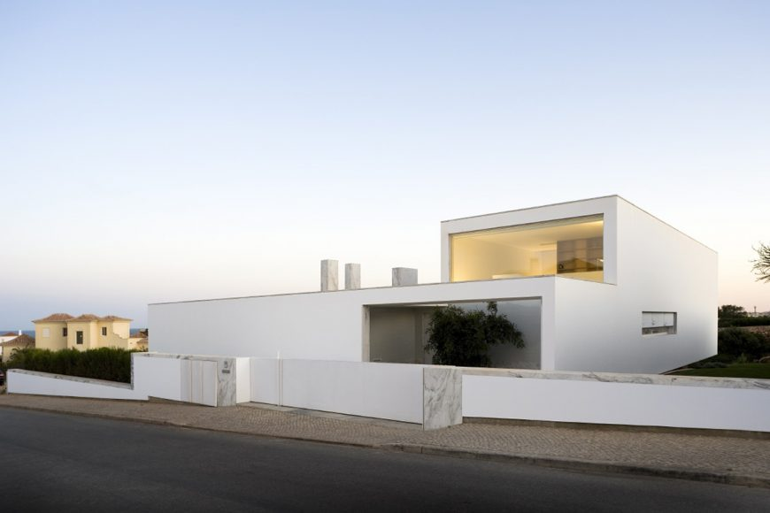
