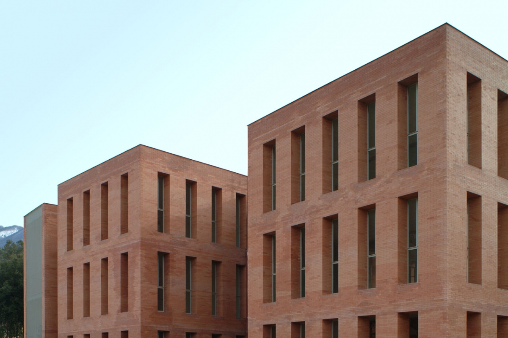
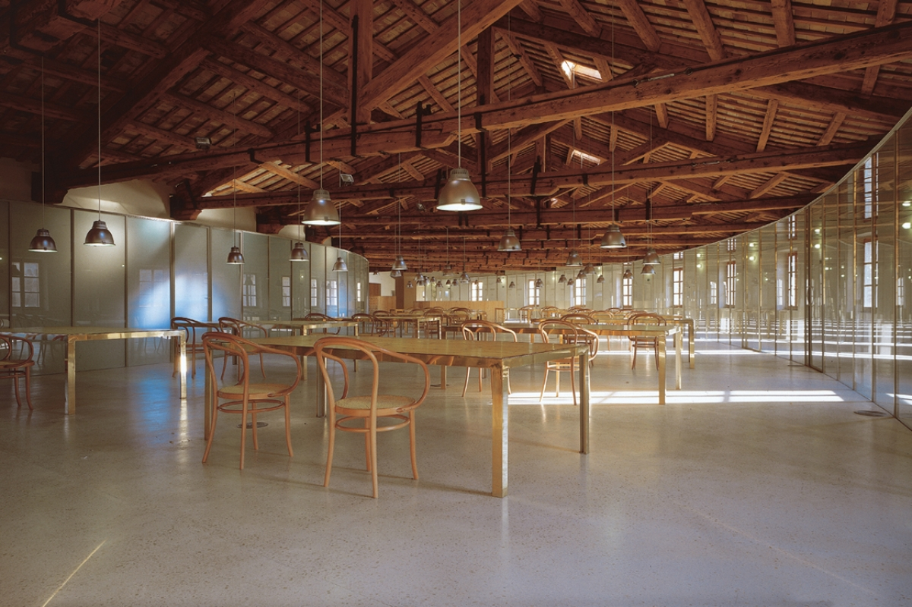
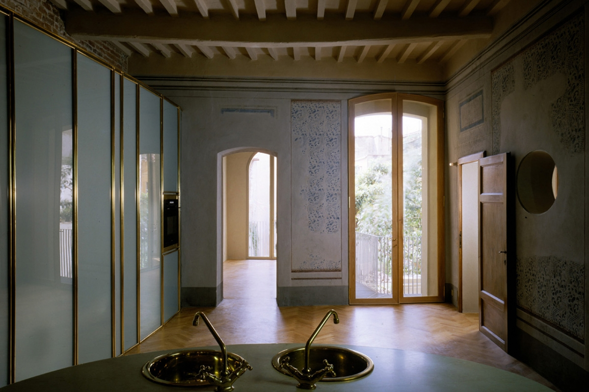
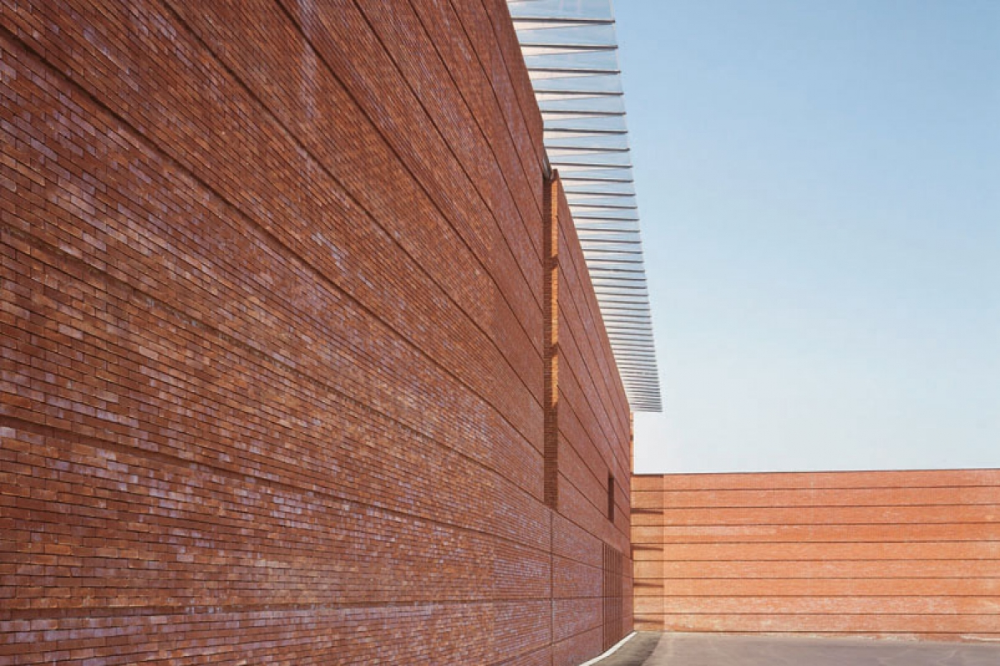
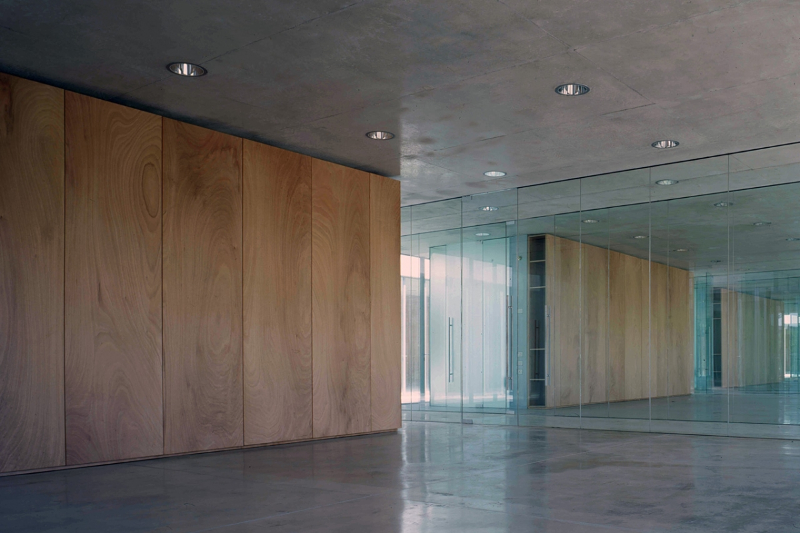
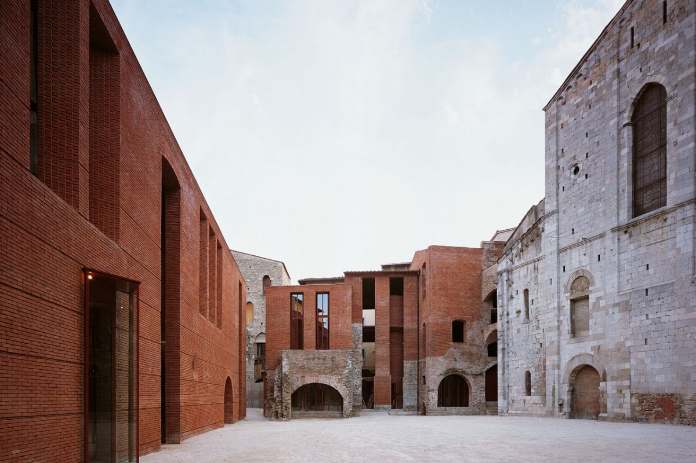
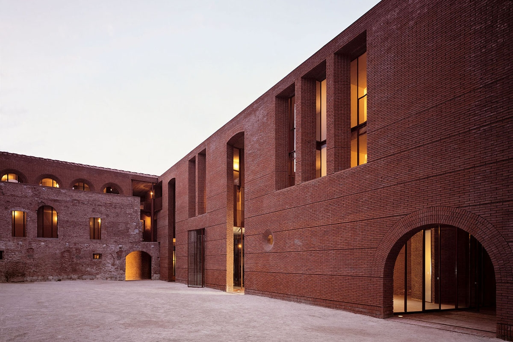
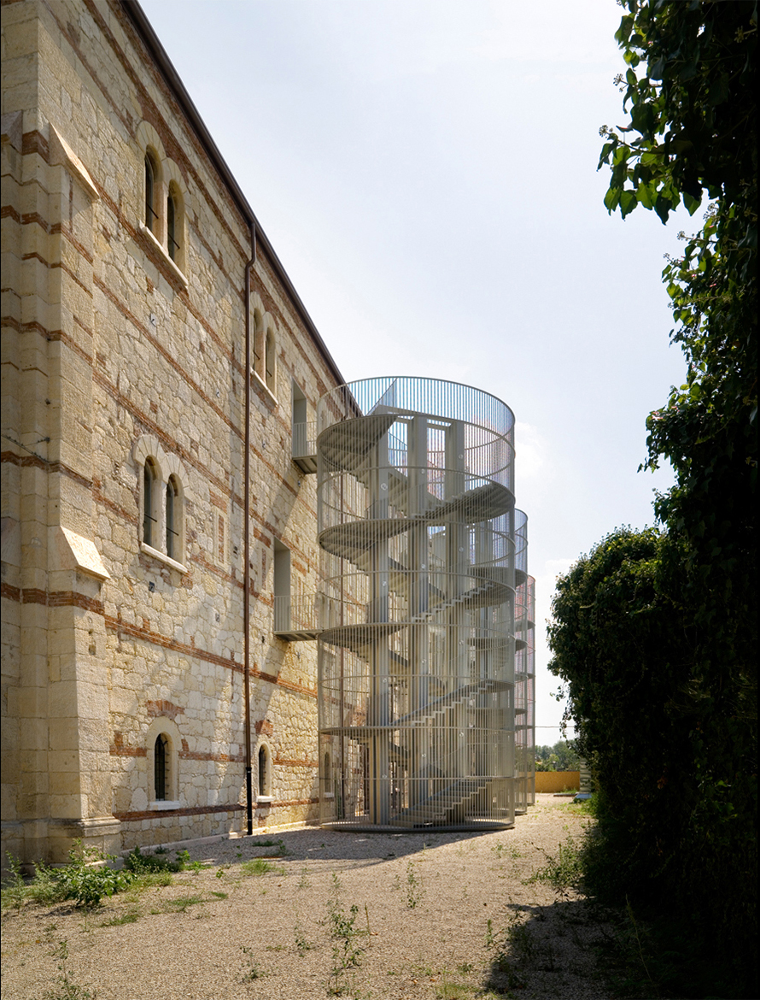

# Massimo Carmassi

#### Massimo Carmassi was born in San Giuliano Terme, Pisa, on the 5th June of 1943. He graduated with the maximum valuation and honours in the School of Architecture of Florence, in the academic year 1968-1969 with a thesis about the restructuration of the University of Pisa.

He began practicing in 1970, and four years later he founded the “Ufficio Progetti” in Pisa, leading it until 1990. Meanwhile he has taught architecture in many universities such as Ferrara, Genova, Torino, Reggio Calabria, at the Institute of Architecture of Venice, in the Academy of Mendrisio, at the Hochschule der Kunst of Berlin and at the Syracuse University of New York. He has been the president of the Order of Architects of Pisa from 1981 to 1985. From 1990 he started a collaboration with his wife Gabriella and other architects that leads to the Professional Association foundation in 1997. Among the various awards he won the Gold Medal for Italian Architecture in 2009, 2015 and 2016.

> «Di fatto le architetture antiche si presentano ai nostri occhi come la somma degli infiniti interventi di generazioni di committenti, abitanti, architetti; si tratta di architetture figlie di molti autori, spesso sconosciuti. Tutto ciò ha generato in questi edifici un grande valore, una rara bellezza difficilmente catalogabile e dettata spesso dal caso o dalla contingenza: il nostro fine ultimo è quello di conservare e restituire tale ricchezza, non solo in termini di patrimonio documentario ma anche in termini di combinazione estetica.»

Da Costruire in laterizio.

---

> «Un restauro che fa capire come passato e presente, in architettura, non siano antitetici, ma complementari. E poiché l’intervento sull’esistente sarà sempre più il terreno principale su cui sviluppare i progetti, quest’opera costituisce un modello e un insegnamento.»

Sul restauro di S. Michele in Borgo.

---

[Bibliography](https://drive.google.com/open?id=12gIDA73vuGkW6F9QhsRTqXTwyp5UPYrWZUY8q9p5DGE)

