# Vector Architects

#### Dong Gong founded Vector Architects in 2008 in Beijing. He was appointed as the Distinguished Plym Professor at University of Illinois, and has been teaching Design Studio at Tsinghua University since 2014.

He and Vector Architects have been invited to various exhibitions including 2018 FREESPACE Venice Biennale, and won awards internationally including nominated by Swiss Architectural Award (2018); the Overall Winner of Italian Archmarathon Awards (2016); “Design Vanguard” selected by Architectural Record (2014).

He has been invited as guest speaker and critic by universities, academic and professional institutions including Tsinghua University (China), University of Illinois (USA), Swiss Federal Institute of Technology Zurich (Swiss), Société Fran?aise des Architectes (France), etc. Vector’s projects have been published by “CASABELLA”, “The New York Times”, “A+U”, “Detail”, “The Architectural Review”, “Domus”, etc.

> «No architecture can be off the site. We believe each site has its certain spirit that already exists. It could be a unique landscape, a bustling city scenario, or the lively people and their movements. What we are favored of is to discover such energy through a precise action in architectural space, and transform it into people’s perceptions and lives. It is just like when we put a piece of stone into the water, and it generates ripples around, which enables us to realize the water flow. In this sense, architecture is neither the beginning nor the end. Instead, it is a medium, a medium to connect and reveal.
>
>
>
> Natural light, while illuminates the fixed, tangible materials and boundaries of space, melts their physical limitations simultaneously. Light is an energy that grants suffused emotion and ambience to space. As the sun moves along its trajectory through the day, with the shifting weathers and seasons, this intangible quality is ever-changing. For architecture, light is an “observation” for our eyes, and an “immersion” for body and soul.
>
>
>
> Architecture is the art of “making.” In the Chinese construction industry, many seemingly shortcomings, such as “lags”, “chaos” and “defects”, are something that architects might take advantage of, and transform into positive potentials. We insist on the strategy of “working together with construction workers”. For each project, we send a site architect to participate in the entire process of construction – from the initial manufacture and experimentation of materials, the testing and correction of details, later on to the full supervision and cooperation on site. It is this long lasting process of adaptation and collaboration that gives us more opportunities to learn the wisdom of making from local and on-site workers lively, and constantly amend the limitations and deviations during the design drawing stage.»

---

[Bibliography](https://drive.google.com/open?id=13aLtZF1ks1Oe9SXNTvzHRlfOSA3BVDkCYwgvINI1Lp8)

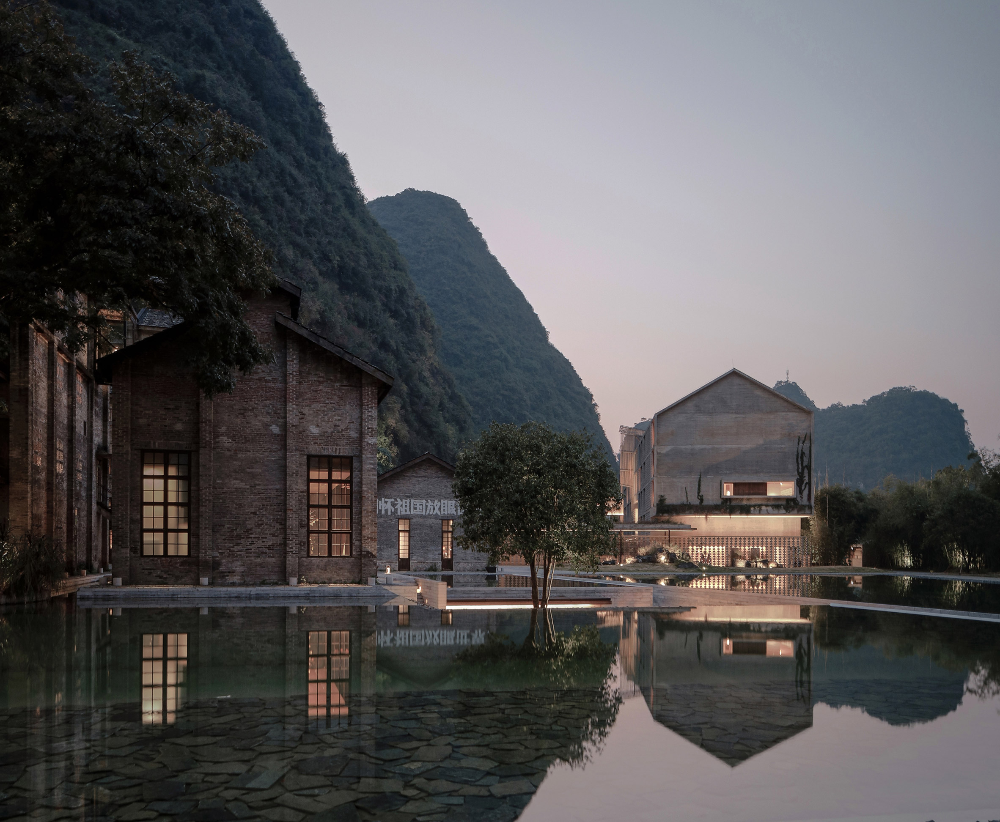

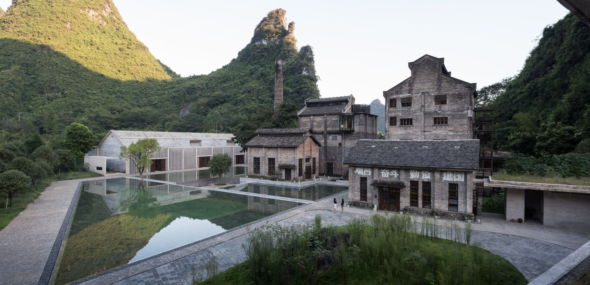

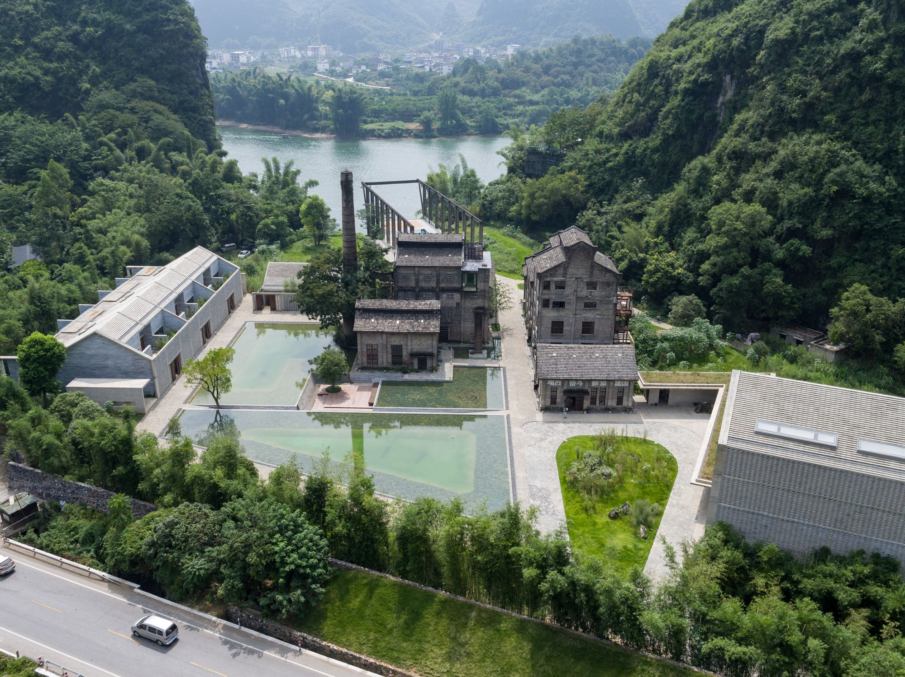

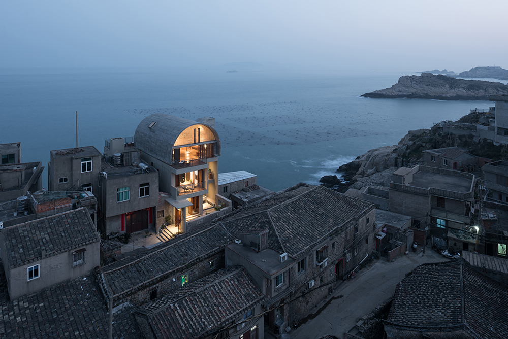

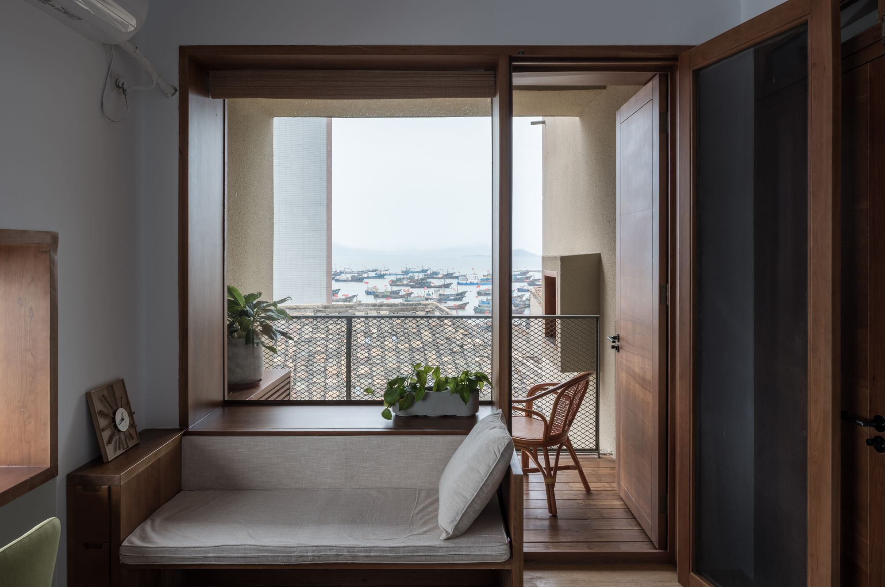

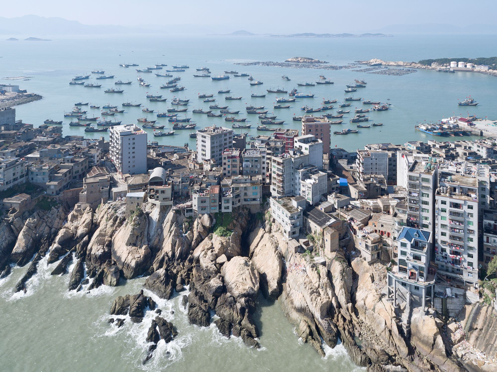

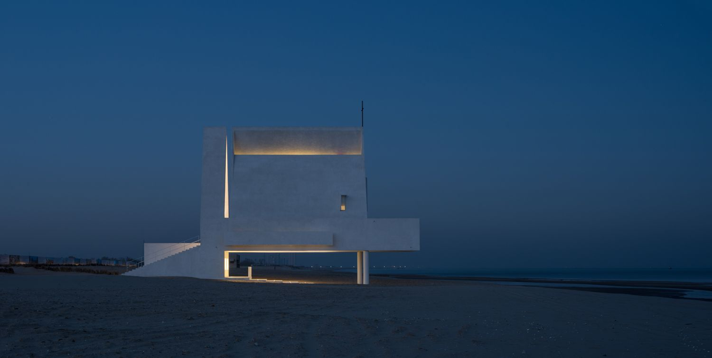

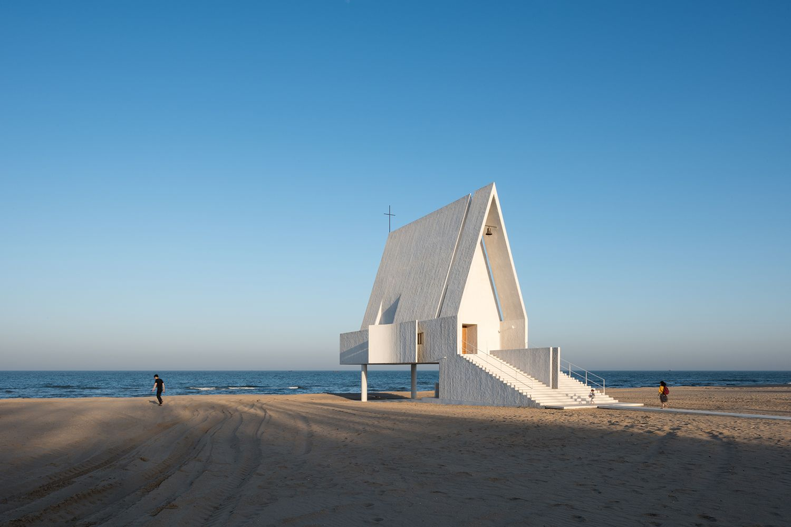

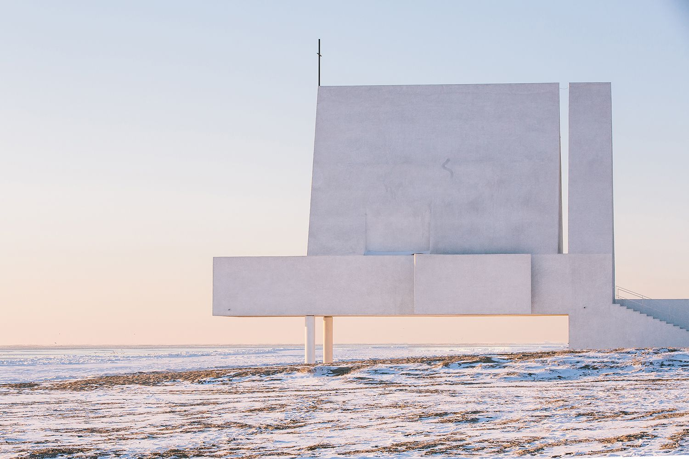

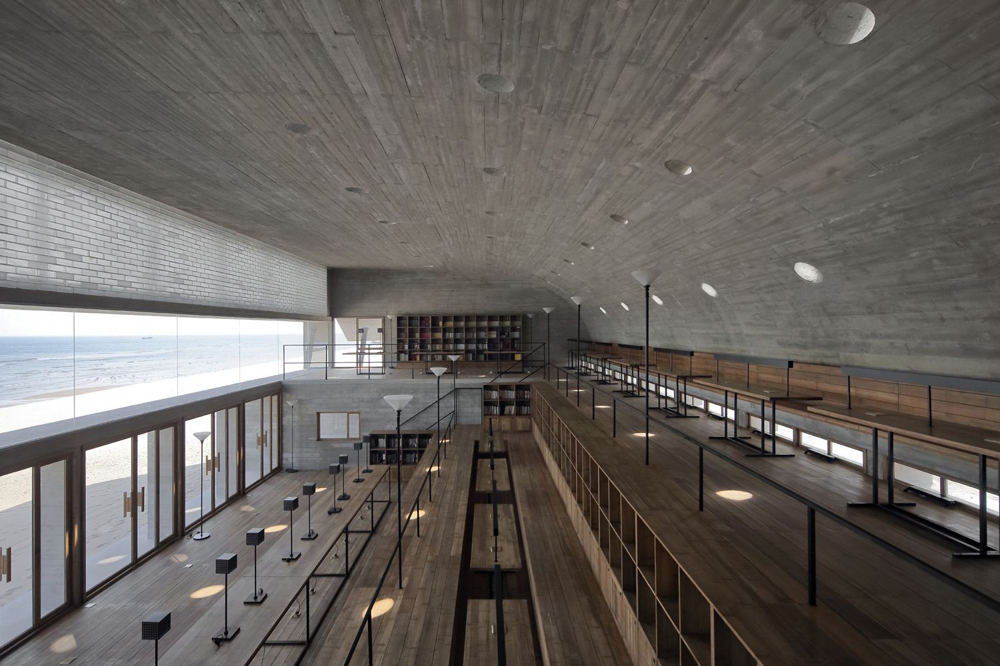

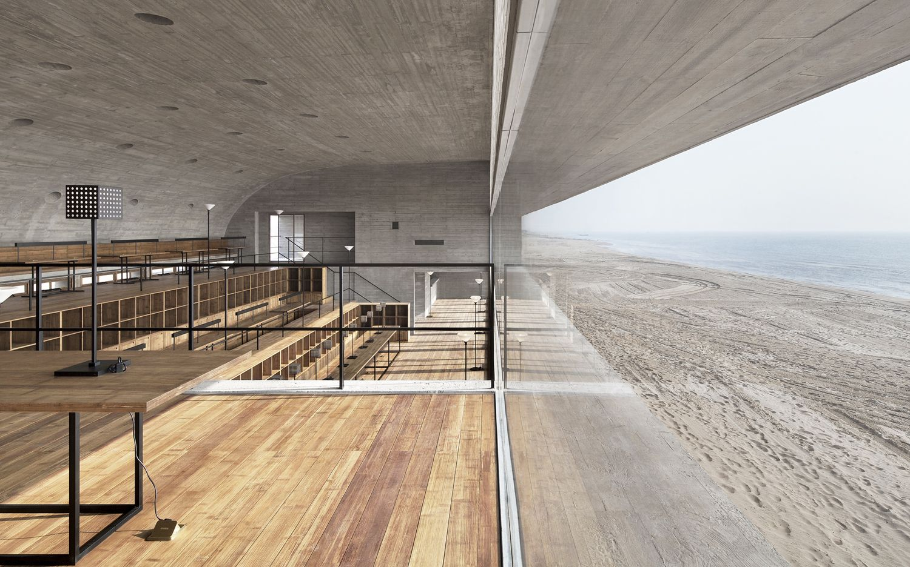

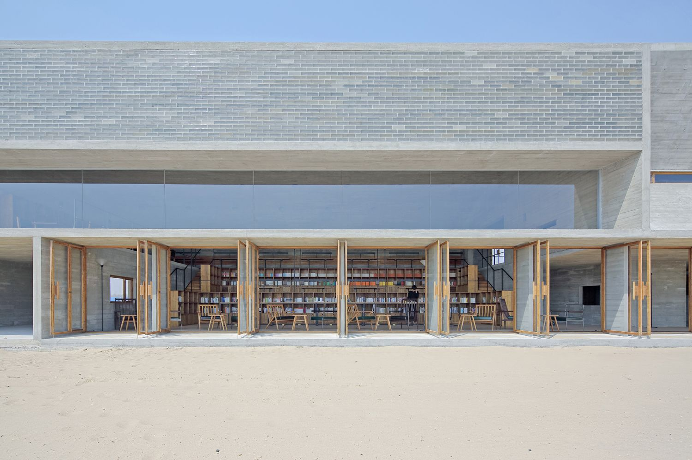

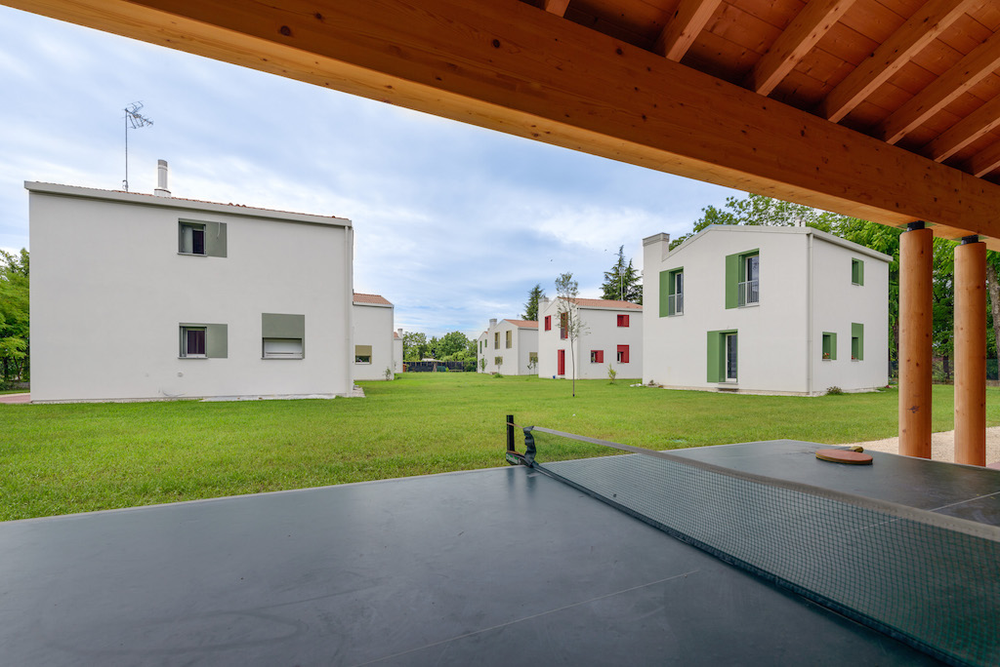
