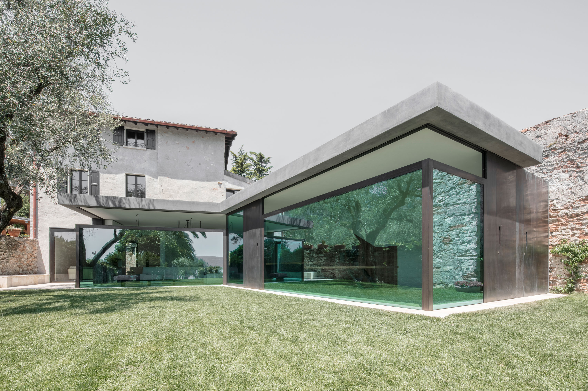
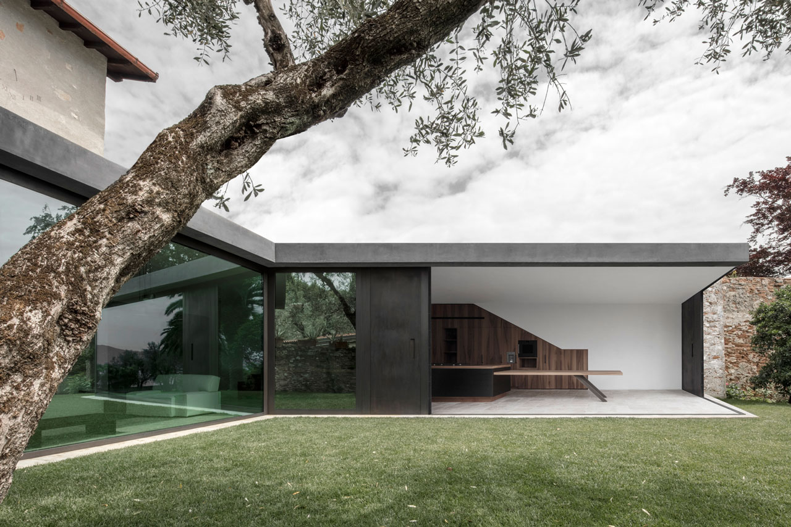
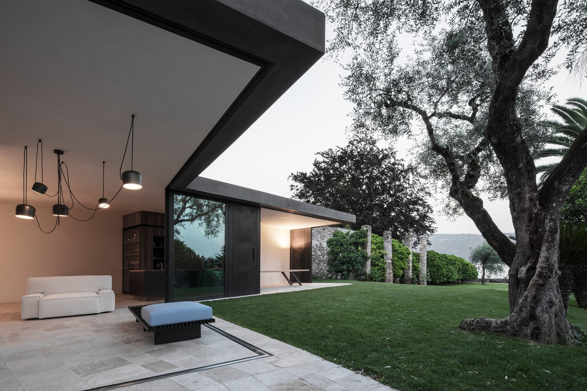
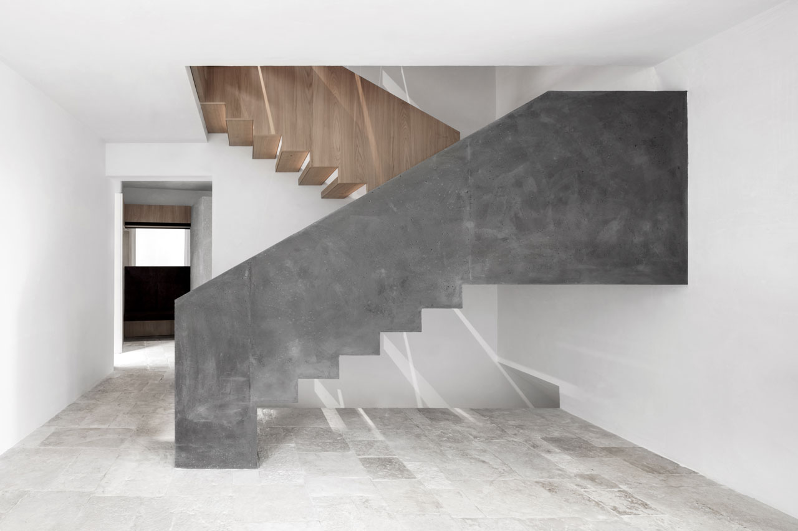
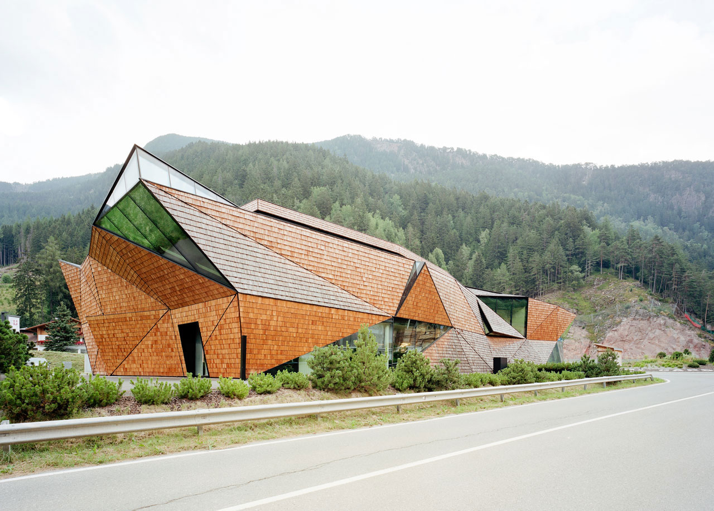
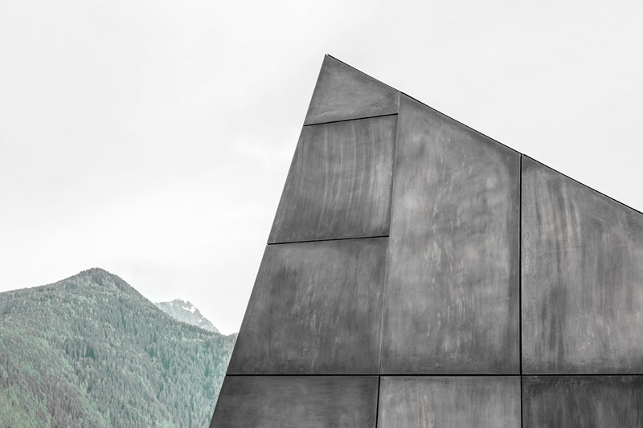
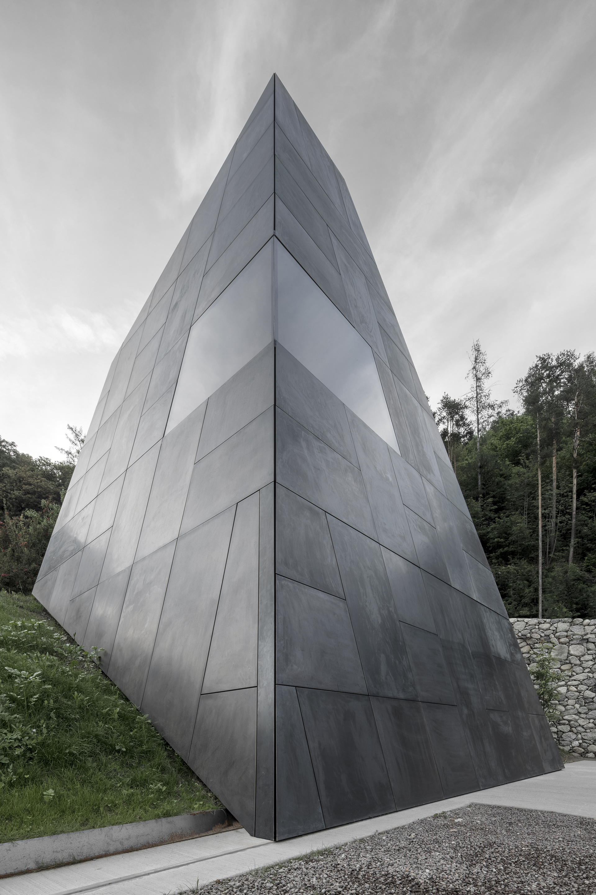
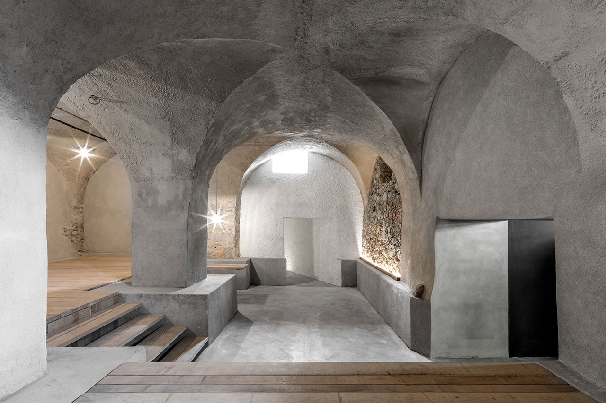
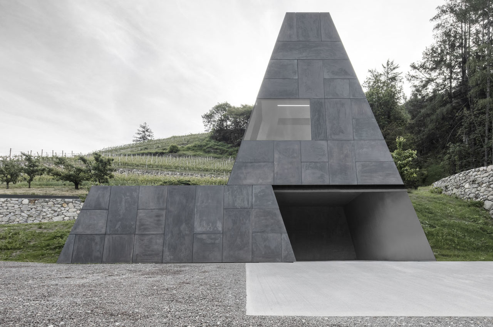

# Bergmeisterwolf

[Bergmeisterwolf](https://www.bergmeisterwolf.it/) is a design and architecture studio based in Brixen and Rosenheim that offers answers to contextual and spatial requests through an intense dialogue with its clients and the academic research. The studio was established by Gerd Bergmeister and Michaela Wolf who work in close collaboration with architects, artists and a network of professionals from different fields. Bergmeisterwolf works include architecture and interior design in hospitality, residential, cultural and commercial buildings, both private and public at different scales.

The singularity of each intervention results from the measured pursue for a new balance in the territory: Bergmeisterwolf re-discovers antique construction techniques while introducing and experimenting with new ones; it recognizes and enhances the continuity of existing buildings and, at the same time, it heightens them with new discontinuity elements, it recovers the shapes of the place and is contaminated by new contemporary languages, it builds underneath the existing morphology and transforms the landscape. Bergmeisterwolf works with the past, the present and the future as a way to understand and reveal the identity of the place.

---

**Arch. Gerd Bergmeisterwolf** studied architecture at IUAV in Venice and Leopold Franzens University in Innsbruck.

**Prof. Arch. Michaela Bergmeisterwolf** studied architecture at the Leopold Franzens University in Innsbruck, at the Architectural Association in London and at the Politecnico in Milan. Since 2017 is professor “Entwurf und Raum” at the Technische Hochschule Rosenheim.

