# noa*

[noa*](https://www.noa.network/) is the essential expression of a collaborative work-ethos: the young team of architects & designers, led by founders Lukas Rungger and Stefan Rier and based in Bolzano (Italy) and Berlin (Germany), explores and examines interdisciplinary methods of design, continuously evolving depending on both nature and requirements of each project. By following the concept of “emergence”, where the whole is perceived as being far greater than the sum of its parts, a holistic approach and strategy is central to noa*s way of conceiving design.

Lukas and Stefan met, while working as project architects with the renowned architect and designer Matteo Thun in Milan, being responsible for a series of challenging projects in the field of tourism, modern living and contemporary workplaces. Before joining forces to found noa* back home in Bozen/Bolzano in 2010, both Lukas and Stefan improved their skills and fine-tuned their work- ethos during a decade of work experiences both locally and abroad. From many years of working in New York, London, Berlin, Milan, Ferrara and Graz, they gained in depth cultural and social insight, which until present, remains a crucial influence and input in their designs. In 2018 noa* has expanded even further, founding their second office in Berlin.

---

> … back in 2010 we established ourselves in Bolzano founding noa*, deliberately conceived as a “network” as this truly reflects the spirit of our work; the way we think and live.

Lukas Rungger

---

**Lukas Rungger** (born 1977) graduated in architecture from the Technical University Graz (AT) and after additional studies in Brussels (BE), he first worked as an architect with Prof. Hans Gangoly in Graz (AT), then with Softroom Architects in London (UK) and finally in Milan (IT) with Matteo Thun. After having completed his thesis in New York City (USA) followed by his professional qualification as an architect from IUAV Venezia (IT), Lukas has been extensively involved in a wide range of projects mainly in the field of master-planning, housing, hotels and interior architecture of bars and restaurants. He was a member of the RIBA Royal Institute of British Architecture and is now a member of the Architectural Chamber of Bozen/Bolzano.

**Stefan Rier** (born 1979) graduated in interior design from Centro Studi “Andrea Palladio“, Verona (Italy) and in architecture from the Technical University Ferrara (Italy). He first worked as an architect and project leader with Arch. Demetz, then moved to Bergamo (Italy) to work with Prof. Massimiliano Mandarini and finally in Milan (Italy) with Matteo Thun. He received his professional qualification as an interior designer and architect from the Universita di Genova. Stefan has been focusing on a series of projects from sustainable housing to hotels, extending to interiors, landscaping and bespoke furniture design. He is now a member of the Architectural Chamber of Bozen/Bolzano.

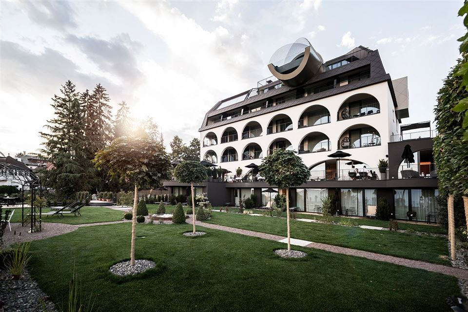

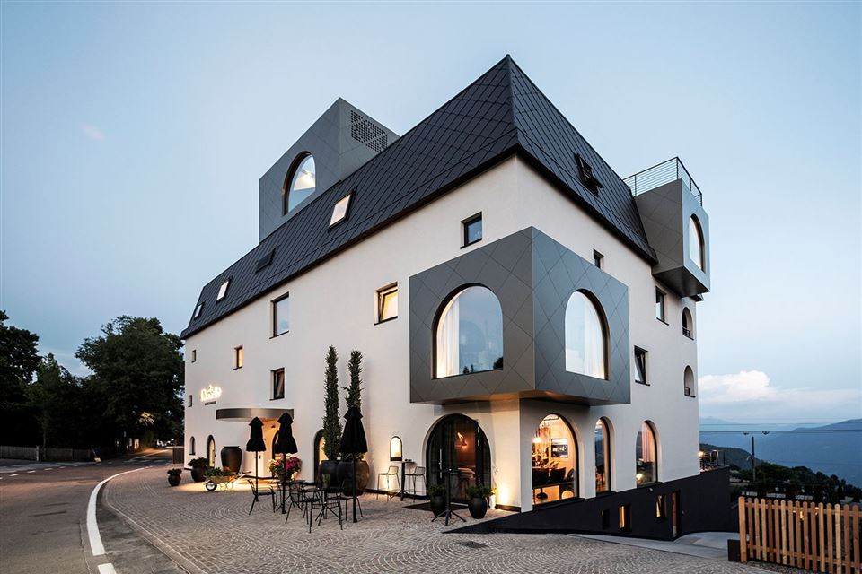

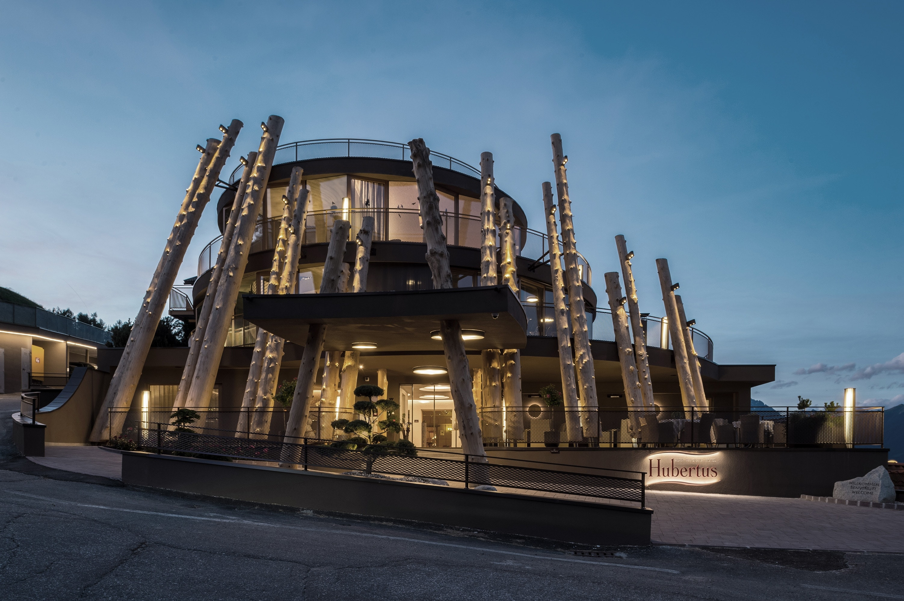

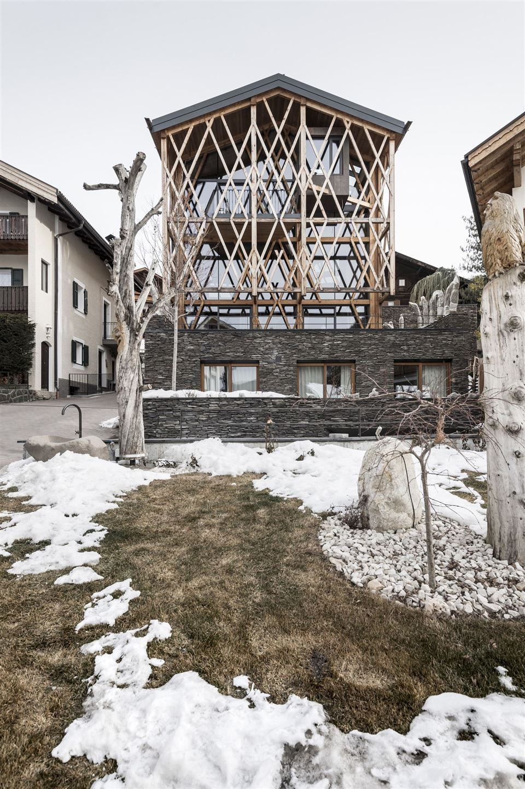

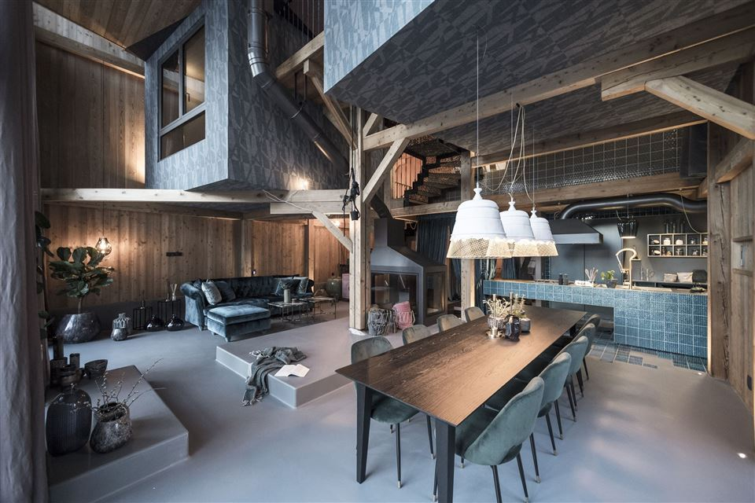

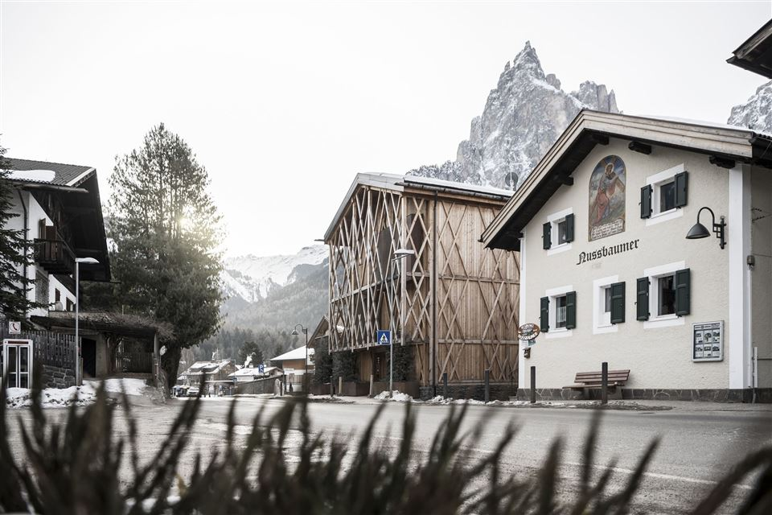

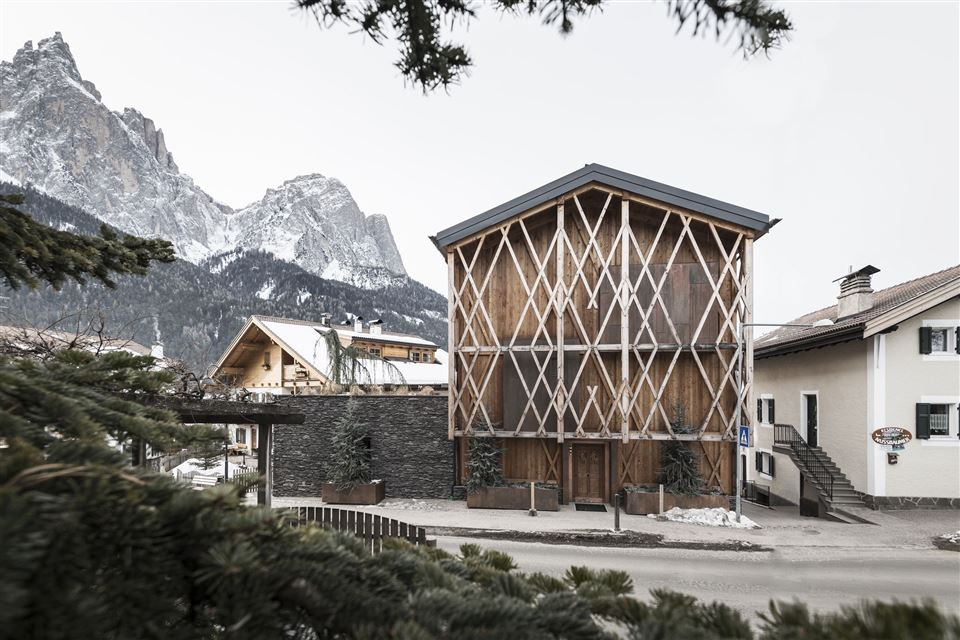

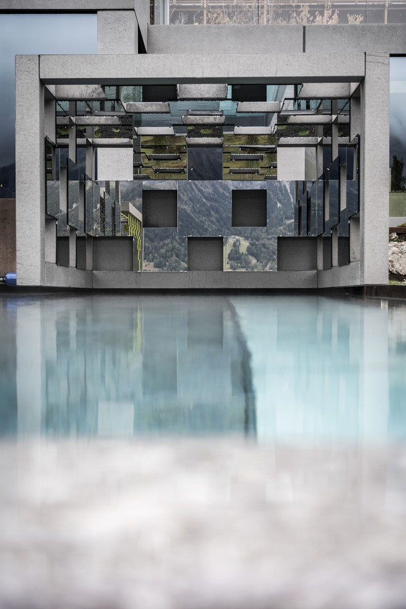

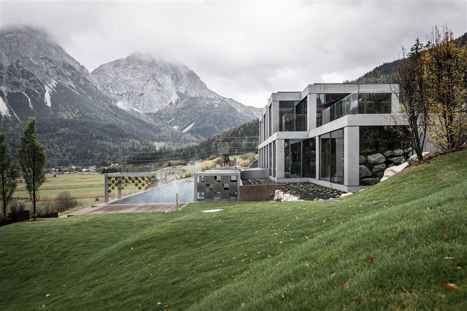

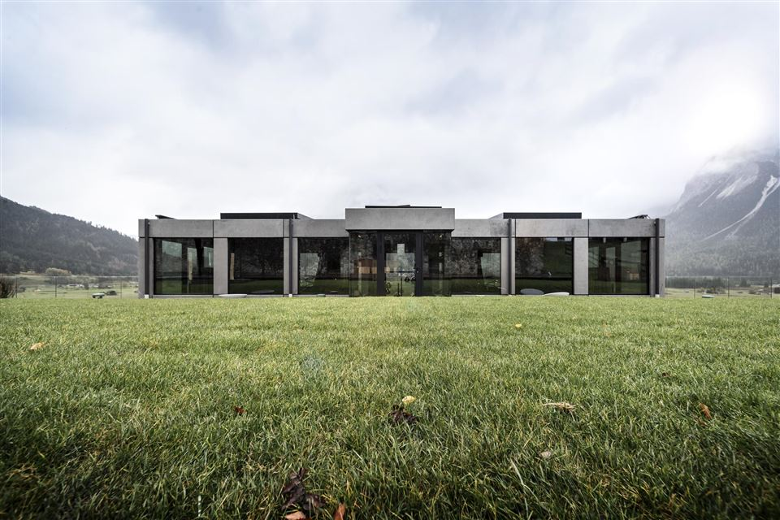

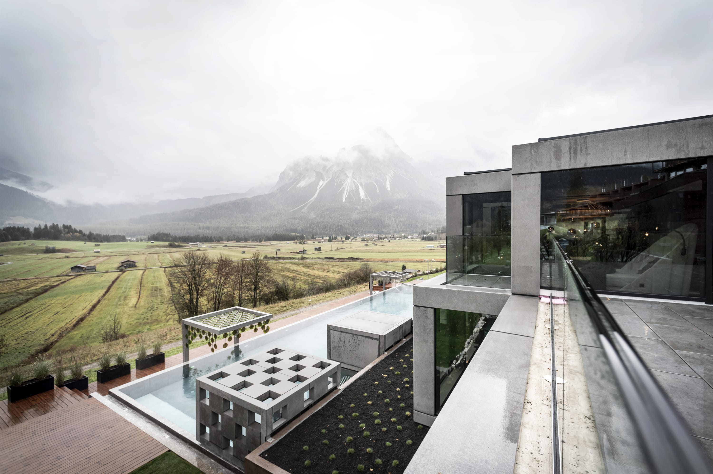

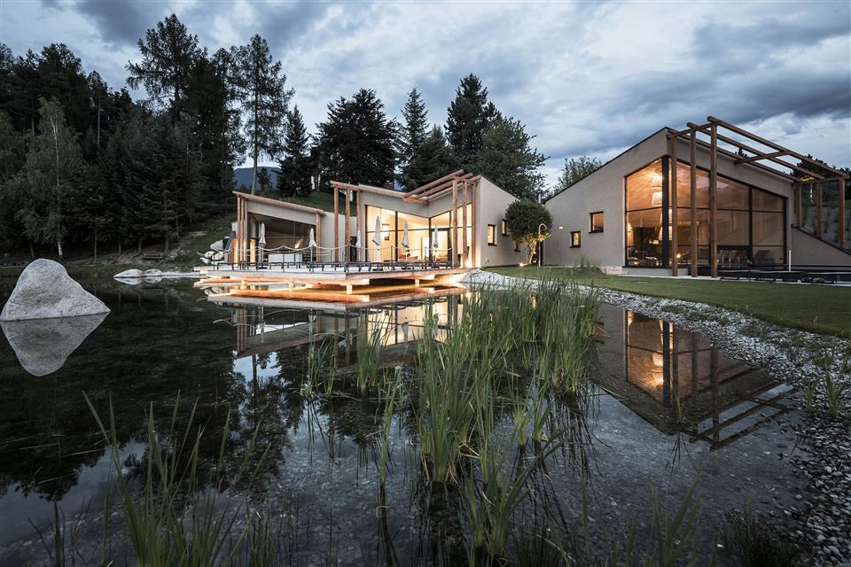

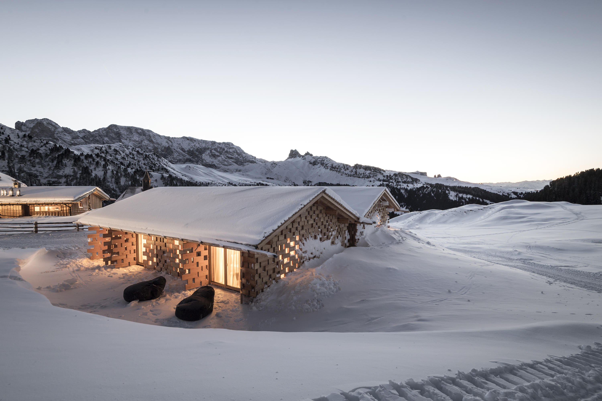
