# Room11 Architects

[Room11](https://room11.com.au/) has a reputation for creating exquisite and specific architecture in Tasmania. A sensitivity to, and preoccupation with, the superlative Tasmanian landscape typifies our work which includes D’Entrecasteaux House, Lighthouse, GASP!, Highway House, Lookout House and Little Big House. The architecture of Room11 has been widely published and can be found in books by Taschen, Gestalten and Thames & Hudson. Room11 is exhibiting at La Biennale di Venezia, 2018.

---

Sign up for our newsletter to stay updated on the conference schedule.

[sign me up please!](http://eepurl.com/ghh0lb)

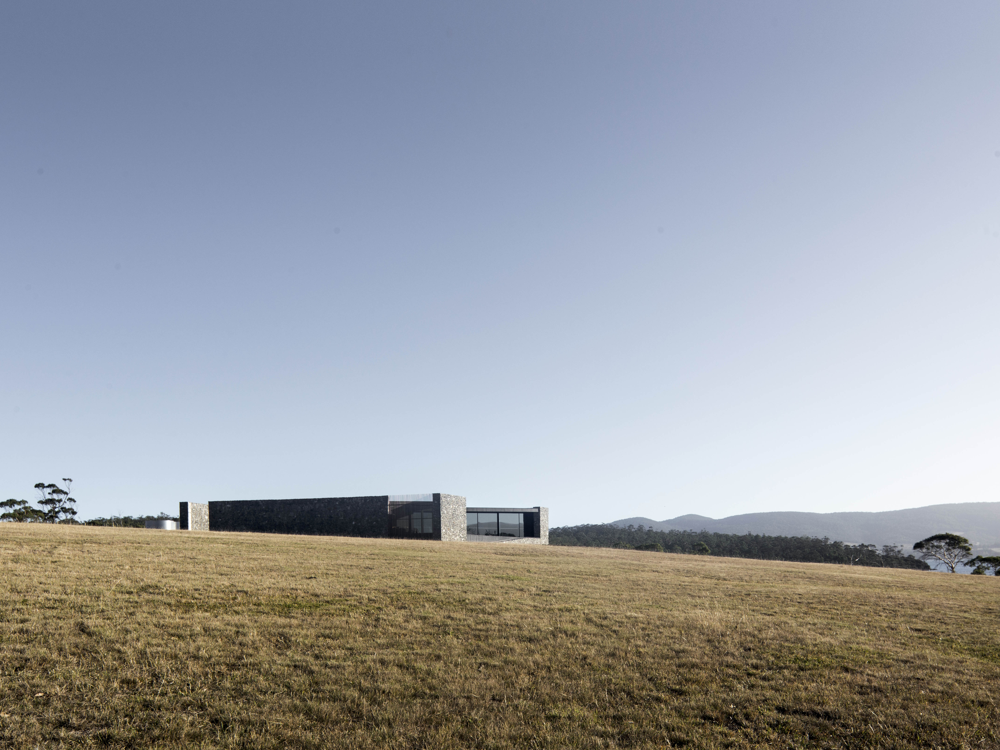

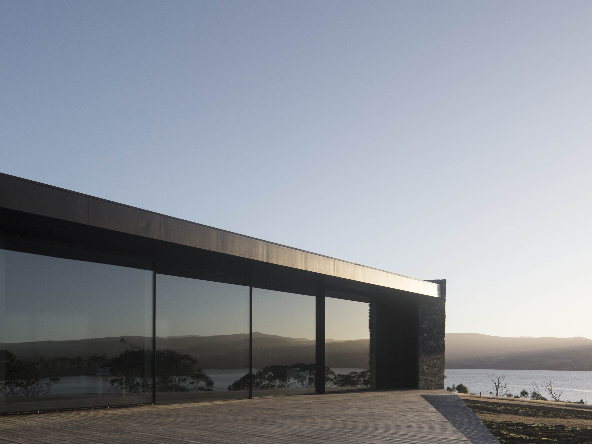

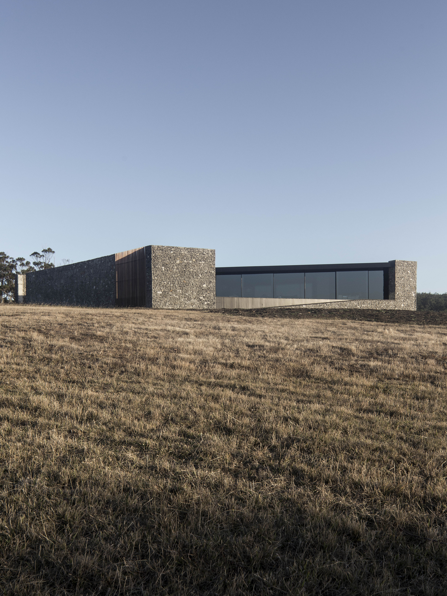

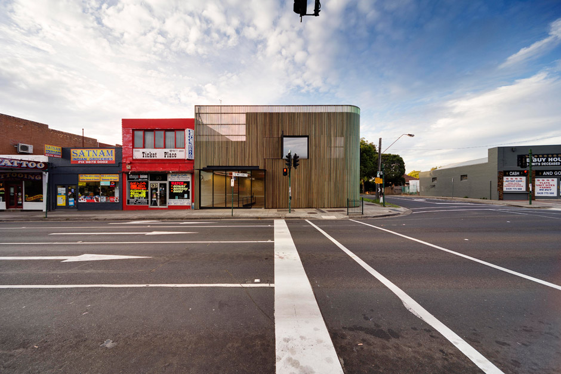

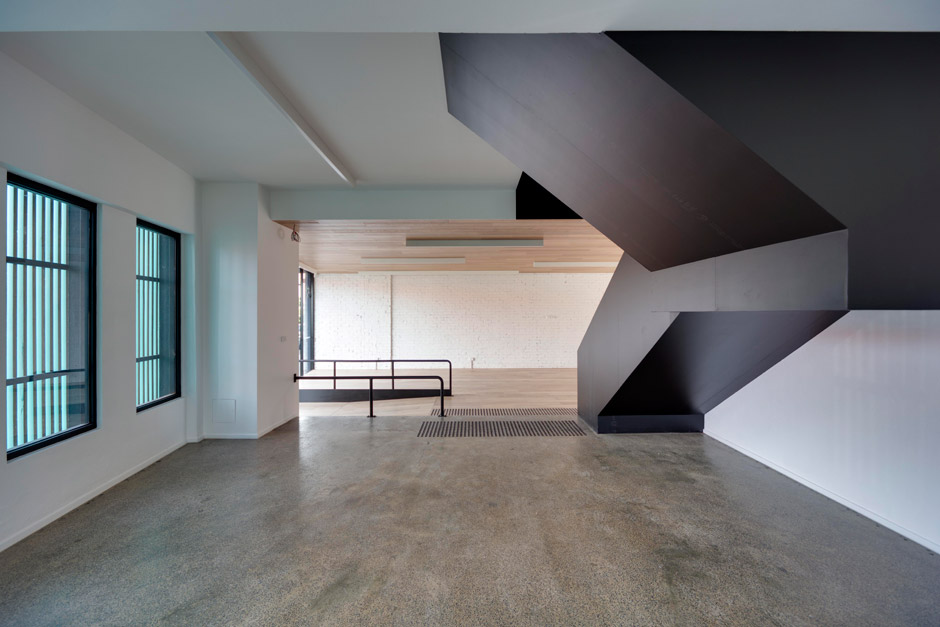

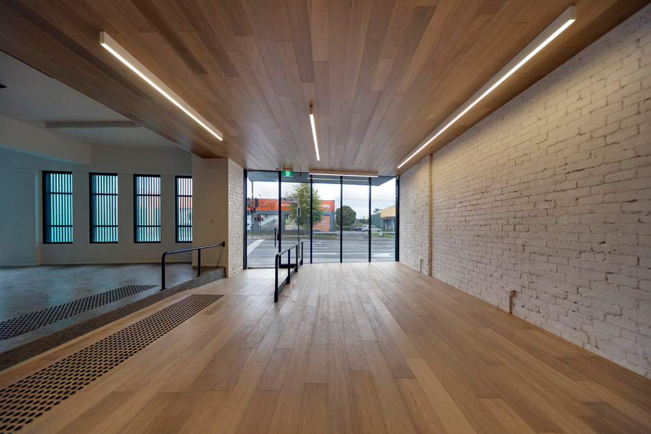

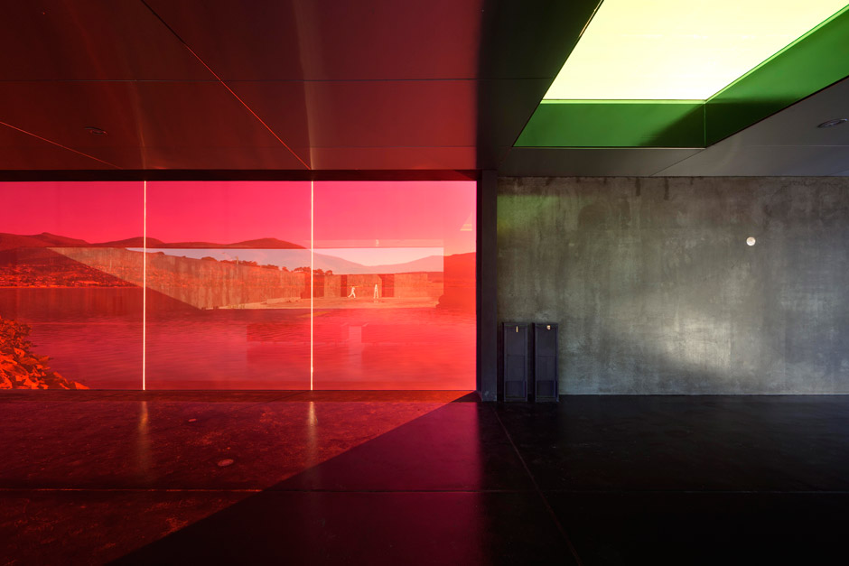

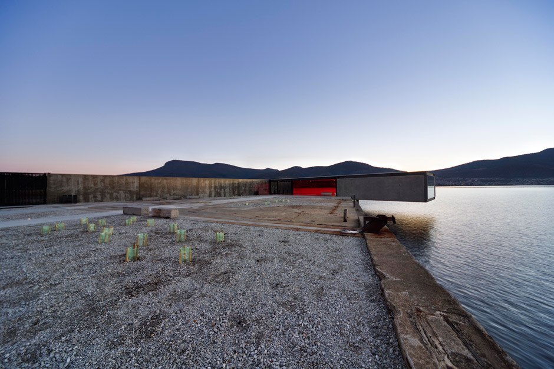

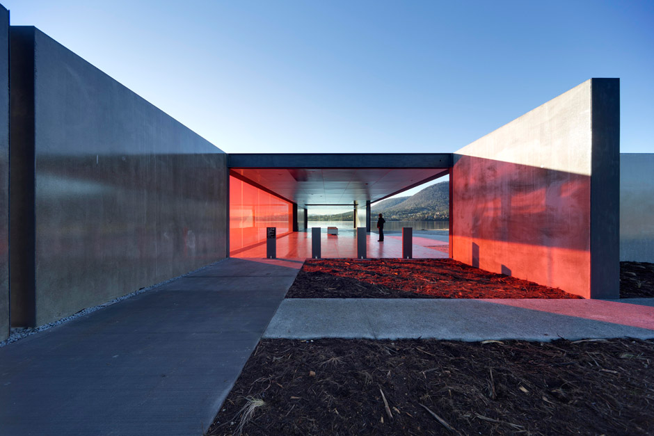

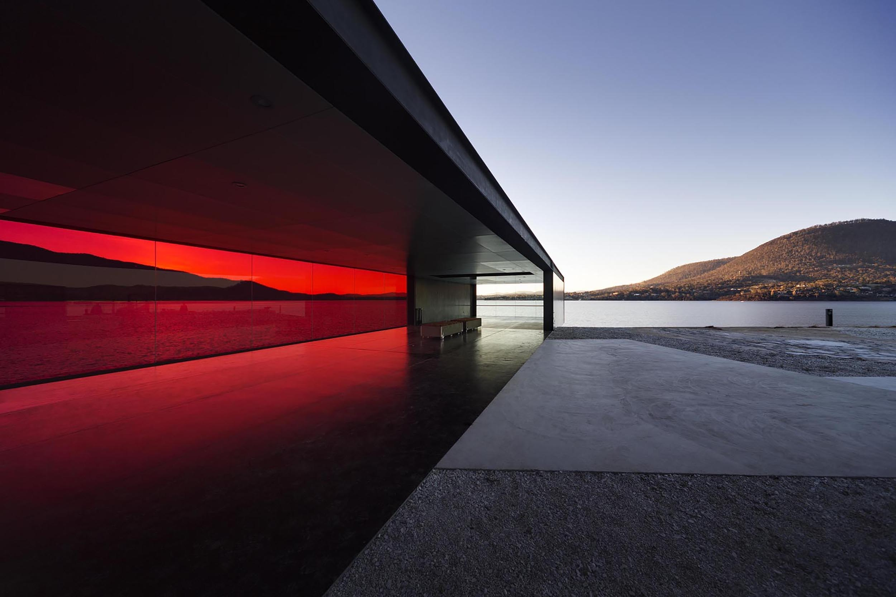

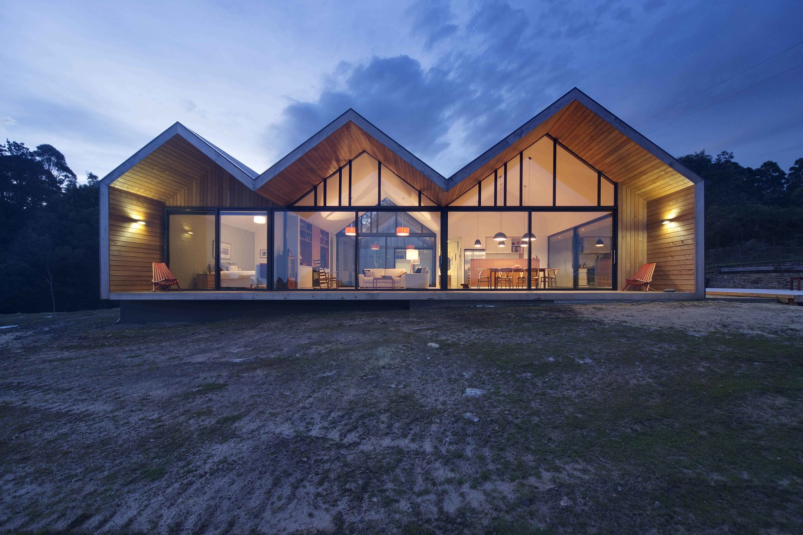

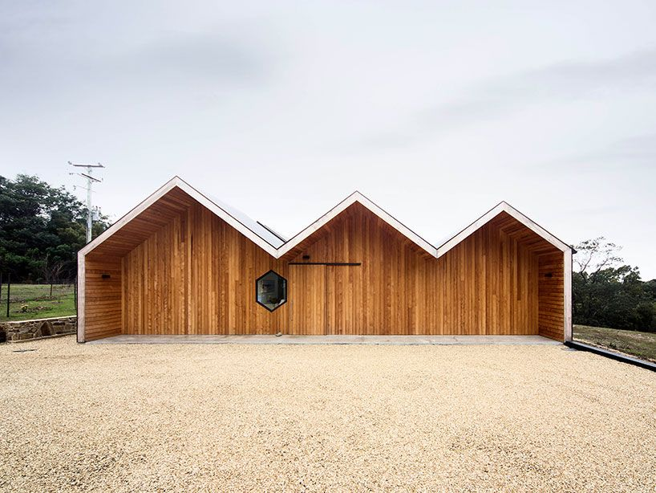

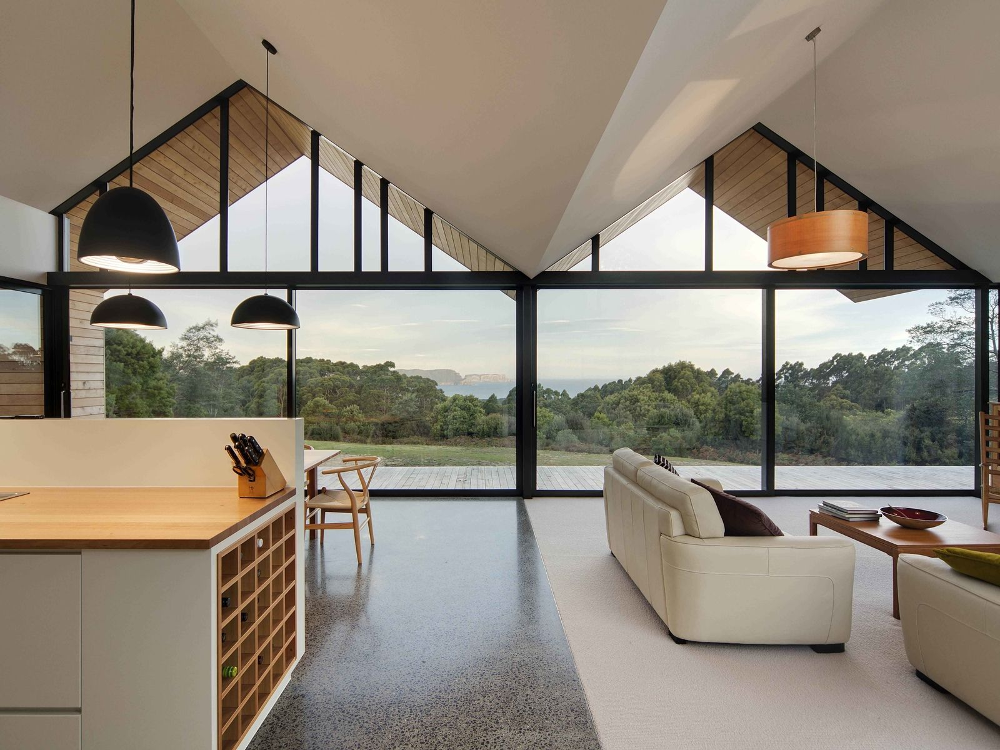
